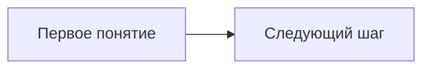

<!-- Назовите файл «26.MM.DD — Название лекции.md»: имя станет заголовком страницы. -->
<!-- Если тема требует уточнения, добавьте здесь одну строку курсивом. -->

> [!abstract]+ 🎯 План лекции
> 1. Основной вопрос
> 2. Второй вопрос

<!-- Замените пример содержательной схемой связей или хронологии из лекции. -->

## 📚 Первый вопрос

Текст конспекта.

> [!info] 📌 Ключевое понятие или событие
> Короткое определение или вывод из лекции.

## ✍️ Второй вопрос

Текст, формулы, примеры и таблицы по теме.

## 🗂️ Сводка

| Вопрос | Главное |
| --- | --- |
| Первый | Краткий вывод |
| Второй | Краткий вывод |

## 📖 Термины

- **Термин** — определение из лекции.

## ✅ Что проверить

> [!todo] 📝 Самопроверка
> - [ ] Проверить ключевое понятие на примере.
> - [ ] Повторить основной вывод.
