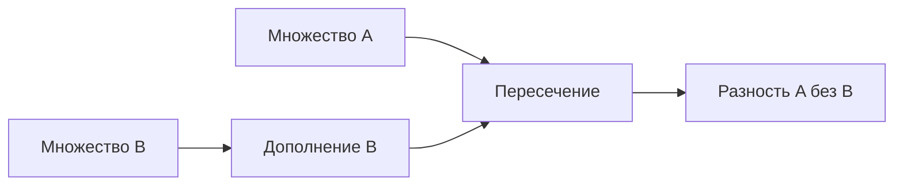

> [!abstract]+ 🎯 План лекции
> 1. Множества и операции над ними
> 2. Числовые множества
> 3. Алгебраическая форма комплексного числа и действия с ним

## 🧩 Множества и операции

Пусть $A, B$ — множества, $a, b$ — элементы множеств.

* $A \subset B$ — $A$ содержится в $B$ ($A$ является подмножеством $B$).
* $a \in A$ — элемент $a$ принадлежит множеству $A$.

### Операции над множествами
1. **Объединение:** $A \cup B = \{a \mid a \in A \text{ или } a \in B\}$
2. **Пересечение:** $A \cap B = \{a \mid a \in A \text{ и } a \in B\}$
3. **Разность:** $A \setminus B = \{a \mid a \in A \text{ и } a \notin B\}$
4. **Дополнение (отрицание):** $\bar{A} = \{a \mid a \notin A\}$

### Свойства операций
* **Коммутативность:**
  $$A \cup B = B \cup A, \quad A \cap B = B \cap A$$
* **Ассоциативность:**
  $$(A \cup B) \cup C = A \cup (B \cup C), \quad (A \cap B) \cap C = A \cap (B \cap C)$$
* **Дистрибутивность:**
  $$A \cup (B \cap C) = (A \cup B) \cap (A \cup C)$$
  $$A \cap (B \cup C) = (A \cap B) \cup (A \cap C)$$
* **Законы де Моргана:**
  $$\overline{A \cup B} = \bar{A} \cap \bar{B}$$
  $$\overline{A \cap B} = \bar{A} \cup \bar{B}$$
* **Связь разности и пересечения:**
  $$A \setminus B = A \cap \bar{B}$$

## 🔢 Числовые множества

| Обозначение | Множество |
| :---: | :--- |
| $\mathbb{N}$ | Натуральные числа |
| $\mathbb{Z}$ | Целые числа |
| $\mathbb{Q}$ | Рациональные числа |
| $\mathbb{I}$ | Иррациональные числа |
| $\mathbb{R}$ | Действительные числа |

> [!note] Рациональное число
> Число является **рациональным**, если его можно представить в виде конечной десятичной дроби либо бесконечной периодической десятичной дроби. Если число не является рациональным, то оно является **иррациональным**.

---

## 🧮 Комплексные числа

Мнимая единица: $i = \sqrt{-1}$, отсюда $i^2 = -1$.

Алгебраическая форма комплексного числа:
$$z = a + bi, \quad a, b \in \mathbb{R}$$

Комплексно-сопряжённое число:
$$\bar{z} = a - bi$$

Произведение числа на его сопряжённое:
$$z \cdot \bar{z} = (a + bi)(a - bi) = a^2 - (bi)^2 = a^2 + b^2$$

### Простейшие действия над комплексными числами
Пусть $z_1 = a_1 + b_1 i$ и $z_2 = a_2 + b_2 i$:

1. **Сложение:**
   $$z_1 + z_2 = (a_1 + a_2) + (b_1 + b_2)i$$
2. **Умножение:**
   $$z_1 \cdot z_2 = (a_1 a_2 - b_1 b_2) + i(a_1 b_2 + a_2 b_1)$$
3. **Деление:**
   $$\frac{z_1}{z_2} = \frac{a_1 + b_1 i}{a_2 + b_2 i} = \frac{a_1 a_2 + b_1 b_2}{a_2^2 + b_2^2} + i \frac{b_1 a_2 - a_1 b_2}{a_2^2 + b_2^2}$$

---

## 🗂️ Сводка

| Тема | Главное соотношение |
| --- | --- |
| Разность множеств | $A \setminus B = A \cap \bar{B}$ |
| Сопряжённое число | $\bar z = a - bi$ для $z = a + bi$ |
| Произведение с сопряжённым | $z\bar z = a^2 + b^2$ |

## 📖 Термины

- **Подмножество** — множество $A$, все элементы которого принадлежат $B$.
- **Комплексное число** — число вида $a+bi$, где $a,b\in\mathbb R$ и $i^2=-1$.
- **Сопряжённое число** — $a-bi$ для числа $a+bi$.

## ✅ Что проверить

> [!todo] 📝 Самопроверка
> - [ ] Выразить разность множеств через пересечение и дополнение.
> - [ ] Проверить законы де Моргана на собственном примере.
> - [ ] Выполнить сложение и умножение двух комплексных чисел; проверить результат для $z\bar z$.
