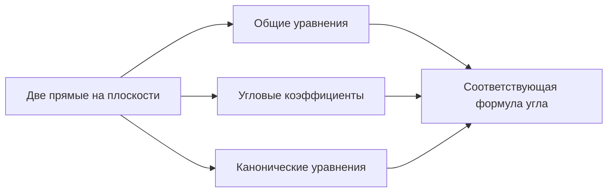

> [!abstract]+ 🎯 План лекции (лекция 8)
> 1. 📐 **Угол между прямыми** по трём видам уравнений: общему, с угловым коэффициентом, каноническому
> 2. ✅ **Условия параллельности и перпендикулярности**
> 3. 🔺 **Задача про треугольник** (медиана, высота, параллельная прямая, косинус и тангенс угла)
> 4. 🧊 **Уравнение плоскости в пространстве**

> [!info] 🔗 Связь с прошлой лекцией
> Продолжение темы [[20.10.26 — Прямая на плоскости, виды уравнений]].

## 📐 1. По общему уравнению

$$L_1:\;A_1x+B_1y+C_1=0\qquad L_2:\;A_2x+B_2y+C_2=0$$

Нормали: $\vec n_1(A_1;B_1)$, $\vec n_2(A_2;B_2)$.

Угол между прямыми равен углу между их нормалями: $\widehat{(L_1,L_2)}=\widehat{(\vec n_1,\vec n_2)}$.

> [!important] 🧮 Формула
> $$\cos(\widehat{L_1,L_2})=\cos(\widehat{\vec n_1,\vec n_2})=\frac{\vec n_1\cdot\vec n_2}{|\vec n_1|\cdot|\vec n_2|}=\frac{A_1A_2+B_1B_2}{\sqrt{A_1^2+B_1^2}\,\sqrt{A_2^2+B_2^2}}$$

### ✅ Следствия: условия параллельности и перпендикулярности

| Условие | Вывод | Формула |
|---|---|---|
| $L_1\parallel L_2$ | $\vec n_1$ и $\vec n_2$ **коллинеарны** | $\dfrac{A_1}{A_2}=\dfrac{B_1}{B_2}$ |
| $L_1\perp L_2$ | $\vec n_1\perp\vec n_2$, то есть $\vec n_1\cdot\vec n_2=0$ | $A_1A_2+B_1B_2=0$ |

---

## 📈 2. По угловым коэффициентам

$$L_1:\;y=k_1x+b_1\qquad L_2:\;y=k_2x+b_2$$

$$k_1=\operatorname{tg}\alpha_1\qquad k_2=\operatorname{tg}\alpha_2\qquad \alpha=\alpha_2-\alpha_1$$

$$\operatorname{tg}\alpha=\operatorname{tg}(\alpha_2-\alpha_1)$$

Используем формулу тангенса разности $\operatorname{tg}(x-y)=\dfrac{\operatorname{tg}x-\operatorname{tg}y}{1+\operatorname{tg}x\cdot\operatorname{tg}y}$:

> [!important] 🧮 Формула
> $$\operatorname{tg}\alpha=\left|\frac{k_2-k_1}{1+k_2\cdot k_1}\right|$$

### ✅ Следствия

1. **Параллельность:** $L_1\parallel L_2\iff\alpha=0^\circ$ (или $180^\circ$) $\iff\operatorname{tg}\alpha=0\Rightarrow\;\boxed{k_1=k_2}$
2. **Перпендикулярность:** $L_1\perp L_2\iff\alpha=90^\circ\;\Rightarrow\;\boxed{k_1\cdot k_2=-1}$

---

## 🧭 3. По каноническим уравнениям

$$L_1:\;\frac{x-x_1}{l_1}=\frac{y-y_1}{m_1}\qquad \vec q_1(l_1,m_1)$$

$$L_2:\;\frac{x-x_2}{l_2}=\frac{y-y_2}{m_2}\qquad \vec q_2(l_2,m_2)$$

Угол между прямыми равен углу между направляющими векторами: $\widehat{(L_1,L_2)}=\widehat{(\vec q_1,\vec q_2)}$.

> [!important] 🧮 Формула
> $$\cos(\widehat{L_1,L_2})=\cos(\widehat{\vec q_1,\vec q_2})=\frac{\vec q_1\cdot\vec q_2}{|\vec q_1|\cdot|\vec q_2|}=\frac{l_1l_2+m_1m_2}{\sqrt{l_1^2+m_1^2}\,\sqrt{l_2^2+m_2^2}}$$

### ✅ Следствия

| Условие | Вывод | Формула |
|---|---|---|
| $L_1\parallel L_2$ | $\vec q_1\parallel\vec q_2$ | $\dfrac{l_1}{l_2}=\dfrac{m_1}{m_2}$ |
| $L_1\perp L_2$ | $\vec q_1\perp\vec q_2$, $\vec q_1\cdot\vec q_2=0$ | $l_1l_2+m_1m_2=0$ |

---

## 🔺 4. Задача про треугольник

Даны вершины треугольника: $A(3;5)$, $B(-2;1)$, $C(1;-4)$.

**Найти:**
1. уравнение медианы $AM$
2. уравнение высоты $BH$
3. уравнение прямой $CC_1$, параллельной $AB$
4. $\cos A$
5. $\operatorname{tg}B$

### 1️⃣ Медиана $AM$

$M$ — середина $BC$:

$$M\left(\frac{x_B+x_C}{2};\frac{y_B+y_C}{2}\right)=M\left(\frac{-2+1}{2};\frac{1-4}{2}\right)=M\left(-\frac12;-\frac32\right)$$

Прямая через две точки $A$ и $M$:

$$AM:\;\frac{x-3}{-\frac12-3}=\frac{y-5}{-\frac32-5}\;\Rightarrow\;\frac{x-3}{7}=\frac{y-5}{13}$$

> [!success] ✅ $AM:\;13x-7y-4=0$

### 2️⃣ Высота $BH$ ($BH\perp AC$)

Условие перпендикулярности: $k_{AC}\cdot k_{BH}=-1$.

$$AC:\;\frac{x-3}{1-3}=\frac{y-5}{-4-5}\;\Rightarrow\;y=\frac92x-\frac{17}{2},\qquad k_{AC}=\frac92$$

$$k_{BH}=-\frac29\quad\left(\text{так как }\frac92\cdot\left(-\frac29\right)=-1\right)$$

Уравнение через точку $B$: $y-y_B=k(x-x_B)$:

$$y-1=-\frac29(x+2)$$

> [!success] ✅ $BH:\;2x+9y-5=0$

### 3️⃣ Прямая $CC_1\parallel AB$

Параллельные прямые имеют равные угловые коэффициенты: $k_{CC_1}=k_{AB}$.

$$AB:\;\frac{x-3}{-2-3}=\frac{y-5}{1-5}\;\Rightarrow\;y=\frac45x+\frac{13}{5},\qquad k_{AB}=\frac45=k_{CC_1}$$

Через точку $C$: $y-y_C=k_{CC_1}(x-x_C)$:

$$y+4=\frac45(x-1)$$

> [!success] ✅ $CC_1:\;4x-5y-24=0$

### 4️⃣ $\cos A$

$\cos A=\cos(\widehat{AC,AB})=\cos(\widehat{\vec n_{AC},\vec n_{AB}})$. Нормали: из $AC:\;9x-2y-17=0$ получаем $\vec n_{AC}=(9;-2)$, из $AB:\;4x-5y+13=0$ получаем $\vec n_{AB}=(4;-5)$.

$$\cos A=\frac{9\cdot4+(-2)(-5)}{\sqrt{81+4}\cdot\sqrt{16+25}}=\frac{46}{\sqrt{85}\cdot\sqrt{41}}$$

### 5️⃣ $\operatorname{tg}B$

$\operatorname{tg}B=\operatorname{tg}(\widehat{AB,BC})=\left|\dfrac{k_{AB}-k_{BC}}{1+k_{AB}\cdot k_{BC}}\right|$.

$$BC:\;\frac{x-x_B}{x_C-x_B}=\frac{y-y_B}{y_C-y_B}\;\Rightarrow\;\frac{x+2}{3}=\frac{y-1}{-5}\;\Rightarrow\;y=-\frac53x-\frac73,\qquad k_{BC}=-\frac53$$

$$\operatorname{tg}B=\left|\frac{\frac45+\frac53}{1+\frac45\cdot\left(-\frac53\right)}\right|=\left|\frac{\frac{37}{15}}{-\frac13}\right|=\frac{37}{5}$$

---

## 🧊 5. Уравнение плоскости в пространстве

Плоскость $\Pi$ проходит через $M_0(x_0,y_0,z_0)$ перпендикулярно вектору нормали $\vec n(A,B,C)$. Произвольная точка плоскости $M(x,y,z)$.

$$\overrightarrow{M_0M}=(x-x_0,\;y-y_0,\;z-z_0)$$

Так как $\vec n\perp\Pi$, то $\vec n\perp\overrightarrow{M_0M}$ и $\vec n\cdot\overrightarrow{M_0M}=0$:

$$A(x-x_0)+B(y-y_0)+C(z-z_0)=0$$

$$Ax+By+Cz\underbrace{-Ax_0-By_0-Cz_0}_{D}=0$$

> [!important] 🧮 Общее уравнение плоскости
> $$\Pi:\;Ax+By+Cz+D=0,\qquad \vec n(A;B;C)$$

> [!tip] 🔗 Аналогия с прямой
> Уравнение плоскости получается точно так же, как общее уравнение прямой на плоскости: через вектор нормали и скалярное произведение, только с третьей координатой $z$.

---

## 🗂️ Сводка

| | Через нормали | Через угловые коэффициенты | Через направляющие |
|---|---|---|---|
| **Исходные данные** | $\vec n_1(A_1;B_1)$, $\vec n_2(A_2;B_2)$ | $k_1$, $k_2$ | $\vec q_1(l_1,m_1)$, $\vec q_2(l_2,m_2)$ |
| **Угол** | $\cos\varphi=\dfrac{A_1A_2+B_1B_2}{\sqrt{A_1^2+B_1^2}\sqrt{A_2^2+B_2^2}}$ | $\operatorname{tg}\varphi=\left\lvert\dfrac{k_2-k_1}{1+k_1k_2}\right\rvert$ | $\cos\varphi=\dfrac{l_1l_2+m_1m_2}{\sqrt{l_1^2+m_1^2}\sqrt{l_2^2+m_2^2}}$ |
| **Параллельны** | $\dfrac{A_1}{A_2}=\dfrac{B_1}{B_2}$ | $k_1=k_2$ | $\dfrac{l_1}{l_2}=\dfrac{m_1}{m_2}$ |
| **Перпендикулярны** | $A_1A_2+B_1B_2=0$ | $k_1k_2=-1$ | $l_1l_2+m_1m_2=0$ |

---

## 📖 Термины

- 📐 **Нормаль $\vec n$** — вектор, перпендикулярный прямой или плоскости
- 🧭 **Направляющий вектор $\vec q$** — вектор вдоль прямой
- 📈 **Угловой коэффициент $k$** — тангенс угла наклона прямой
- 🔺 **Медиана** — отрезок из вершины к середине противоположной стороны
- 📏 **Высота** — перпендикуляр из вершины к противоположной стороне
- 🧊 **Плоскость в пространстве** — $Ax+By+Cz+D=0$

---

## ✅ Что проверить

> [!todo] 📝 Мелочи
> - [ ] В п. 5 по формуле с модулем получилось $\frac{37}{5}$, это тангенс **острого угла между прямыми** $AB$ и $BC$. Внутренний угол $B$ в треугольнике тупой (скалярное произведение $\overrightarrow{BA}\cdot\overrightarrow{BC}=-5<0$), его тангенс равен $-\frac{37}{5}$. Уточни, что требуется в задаче
> - [ ] Подставить точку $M_0$ в уравнение плоскости и убедиться, что $D=-Ax_0-By_0-Cz_0$
> - [ ] Решить аналогичную задачу про треугольник с другими вершинами
