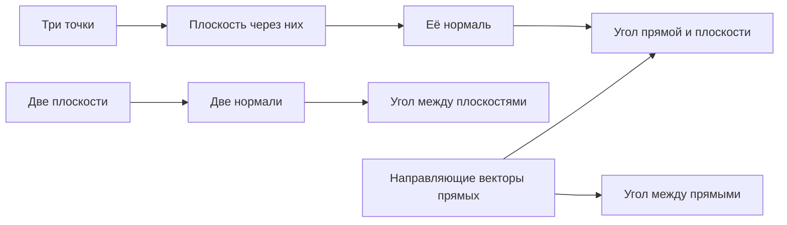

> [!abstract]+ 🎯 План лекции
> 1. 🧊 **Плоскость через три точки**
> 2. 📐 **Угол между плоскостями**, условия параллельности и перпендикулярности
> 3. 📏 **Прямая в пространстве:** каноническое, параметрическое, через две точки, как пересечение плоскостей
> 4. 🔀 **Угол между двумя прямыми**
> 5. 🧭 **Угол между прямой и плоскостью**

> [!info] 🔗 Связь с прошлой лекцией
> Продолжение темы [[27.10.26 — Угол между прямыми на плоскости, уравнение плоскости]]: там выведено общее уравнение плоскости $Ax+By+Cz+D=0$ с нормалью $\vec n(A;B;C)$.

## 🧊 1. Плоскость через три точки

Даны точки $M_1(x_1,y_1,z_1)$, $M_2(x_2,y_2,z_2)$, $M_3(x_3,y_3,z_3)$ и произвольная точка $M(x,y,z)$ плоскости $\Pi$.

> [!important] 📌 Условие
> Чтобы точки $M_1,M_2,M_3,M$ лежали в одной плоскости, нужно, чтобы векторы $\overrightarrow{M_1M}$, $\overrightarrow{M_1M_2}$, $\overrightarrow{M_1M_3}$ были **компланарны**, то есть их **смешанное произведение равно нулю**:
> $$(\overrightarrow{M_1M},\;\overrightarrow{M_1M_2},\;\overrightarrow{M_1M_3})=0$$

Координаты векторов:

$$\overrightarrow{M_1M}(x-x_1,\;y-y_1,\;z-z_1)$$

$$\overrightarrow{M_1M_2}(x_2-x_1,\;y_2-y_1,\;z_2-z_1)$$

$$\overrightarrow{M_1M_3}(x_3-x_1,\;y_3-y_1,\;z_3-z_1)$$

> [!success] 🧮 Уравнение плоскости через три точки
> $$\begin{vmatrix} x-x_1&y-y_1&z-z_1\\ x_2-x_1&y_2-y_1&z_2-z_1\\ x_3-x_1&y_3-y_1&z_3-z_1\end{vmatrix}=0$$

### ✏️ Пример

Записать уравнение плоскости через $A(1;3;5)$, $B(-2;0;4)$, $C(4;-1;-3)$.

$$\begin{vmatrix} x-1&y-3&z-5\\ -2-1&0-3&4-5\\ 4-1&-1-3&-3-5\end{vmatrix}=\begin{vmatrix} x-1&y-3&z-5\\ -3&-3&-1\\ 3&-4&-8\end{vmatrix}=0$$

Раскладываем по первой строке:

$$(x-1)\begin{vmatrix}-3&-1\\-4&-8\end{vmatrix}-(y-3)\begin{vmatrix}-3&-1\\3&-8\end{vmatrix}+(z-5)\begin{vmatrix}-3&-3\\3&-4\end{vmatrix}=0$$

$$20(x-1)-27(y-3)+21(z-5)=0$$

$$20x-27y+21z-20+81-105=0$$

> [!success] ✅ Ответ
> $$20x-27y+21z-44=0,\qquad \vec n(20;-27;21)$$

> [!tip] 🔍 Проверка подстановкой
> - $A$: $20-81+105-44=0$ ✓
> - $B$: $-40-0+84-44=0$ ✓
> - $C$: $80+27-63-44=0$ ✓

---

## 📐 2. Угол между плоскостями

$$\Pi_1:\;A_1x+B_1y+C_1z+D_1=0,\quad\vec n_1(A_1,B_1,C_1)$$

$$\Pi_2:\;A_2x+B_2y+C_2z+D_2=0,\quad\vec n_2(A_2,B_2,C_2)$$

Угол между плоскостями равен углу между их нормалями: $\widehat{(\Pi_1,\Pi_2)}=\widehat{(\vec n_1,\vec n_2)}$.

> [!important] 🧮 Формула
> $$\cos(\widehat{\Pi_1,\Pi_2})=\cos(\widehat{\vec n_1,\vec n_2})=\frac{\vec n_1\cdot\vec n_2}{|\vec n_1|\cdot|\vec n_2|}=\frac{A_1A_2+B_1B_2+C_1C_2}{\sqrt{A_1^2+B_1^2+C_1^2}\,\sqrt{A_2^2+B_2^2+C_2^2}}$$

### ✅ Следствия: условия параллельности и перпендикулярности

| Условие | Вывод | Формула |
|---|---|---|
| $\Pi_1\parallel\Pi_2$ | $\vec n_1\parallel\vec n_2$ | $\dfrac{A_1}{A_2}=\dfrac{B_1}{B_2}=\dfrac{C_1}{C_2}$ |
| $\Pi_1\perp\Pi_2$ | $\vec n_1\perp\vec n_2$, $\vec n_1\cdot\vec n_2=0$ | $A_1A_2+B_1B_2+C_1C_2=0$ |

---

## 📏 3. Уравнения прямой в пространстве

### 1️⃣ Каноническое уравнение

Прямая $L$ проходит через $M_0(x_0,y_0,z_0)$, $\vec q(l,m,n)$ — **направляющий вектор** (лежит на прямой или параллелен ей). Точка $M(x,y,z)\in L$:

$$\overrightarrow{M_0M}(x-x_0,\;y-y_0,\;z-z_0)\parallel\vec q$$

> [!important] 🧮
> $$L:\;\frac{x-x_0}{l}=\frac{y-y_0}{m}=\frac{z-z_0}{n}$$

### 2️⃣ Параметрическое уравнение

Из канонического: пусть общее значение дробей равно $t$:

$$\frac{x-x_0}{l}=\frac{y-y_0}{m}=\frac{z-z_0}{n}=t\;\Rightarrow\;\begin{cases} x=x_0+l\,t\\ y=y_0+m\,t\\ z=z_0+n\,t\end{cases}$$

### 3️⃣ Через две точки

Даны $M_1(x_1,y_1,z_1)$ и $M_2(x_2,y_2,z_2)$. Для $M(x,y,z)\in L$ векторы $\overrightarrow{M_1M}(x-x_1,y-y_1,z-z_1)$ и $\overrightarrow{M_1M_2}(x_2-x_1,y_2-y_1,z_2-z_1)$ лежат на прямой и параллельны:

> [!important] 🧮
> $$\frac{x-x_1}{x_2-x_1}=\frac{y-y_1}{y_2-y_1}=\frac{z-z_1}{z_2-z_1}$$

### 4️⃣ Как пересечение двух плоскостей

> [!note] 💡 Замечание
> Прямая в пространстве может быть задана как **линия пересечения двух плоскостей**, то есть системой:
> $$\begin{cases} A_1x+B_1y+C_1z+D_1=0\\ A_2x+B_2y+C_2z+D_2=0\end{cases}$$

---

## 🔀 4. Угол между двумя прямыми

$$L_1:\;\frac{x-x_1}{l_1}=\frac{y-y_1}{m_1}=\frac{z-z_1}{n_1}\quad\vec q_1(l_1,m_1,n_1)$$

$$L_2:\;\frac{x-x_2}{l_2}=\frac{y-y_2}{m_2}=\frac{z-z_2}{n_2}\quad\vec q_2(l_2,m_2,n_2)$$

Угол между прямыми равен углу между направляющими векторами: $\widehat{(L_1,L_2)}=\widehat{(\vec q_1,\vec q_2)}$.

> [!important] 🧮 Формула
> $$\cos(\widehat{L_1,L_2})=\cos(\widehat{\vec q_1,\vec q_2})=\frac{\vec q_1\cdot\vec q_2}{|\vec q_1|\cdot|\vec q_2|}=\frac{l_1l_2+m_1m_2+n_1n_2}{\sqrt{l_1^2+m_1^2+n_1^2}\,\sqrt{l_2^2+m_2^2+n_2^2}}$$

### ✅ Следствия: условия параллельности и перпендикулярности

| Условие | Вывод | Формула |
|---|---|---|
| $L_1\parallel L_2$ | $\vec q_1\parallel\vec q_2$ | $\dfrac{l_1}{l_2}=\dfrac{m_1}{m_2}=\dfrac{n_1}{n_2}$ |
| $L_1\perp L_2$ | $\vec q_1\perp\vec q_2$, $\vec q_1\cdot\vec q_2=0$ | $l_1l_2+m_1m_2+n_1n_2=0$ |

---

## 🧭 5. Угол между прямой и плоскостью

$$L:\;\frac{x-x_0}{l}=\frac{y-y_0}{m}=\frac{z-z_0}{n},\quad\vec q(l,m,n)$$

$$\Pi:\;Ax+By+Cz+D=0,\quad\vec n(A,B,C)$$

Угол между прямой и плоскостью дополняет угол между нормалью и направляющим вектором до $90^\circ$:

$$\widehat{(L,\Pi)}=90^\circ-\widehat{(\vec n,\vec q)}$$

$$\sin(\widehat{L,\Pi})=\sin\left(90^\circ-\widehat{(\vec n,\vec q)}\right)=\cos(\widehat{\vec n,\vec q})$$

> [!important] 🧮 Формула
> $$\sin(\widehat{L,\Pi})=\frac{\vec n\cdot\vec q}{|\vec n|\cdot|\vec q|}=\frac{Al+Bm+Cn}{\sqrt{A^2+B^2+C^2}\,\sqrt{l^2+m^2+n^2}}$$

### ✅ Следствия

| Условие | Вывод | Формула |
|---|---|---|
| $L\parallel\Pi$ | $\vec n\perp\vec q$, $\vec n\cdot\vec q=0$ | $Al+Bm+Cn=0$ |
| $L\perp\Pi$ | $\vec n\parallel\vec q$ | $\dfrac{A}{l}=\dfrac{B}{m}=\dfrac{C}{n}$ |

---

## 🗂️ Сводка

| Объекты | Угол | Параллельны | Перпендикулярны |
|---|---|---|---|
| **Плоскость — плоскость** | $\cos\varphi=\dfrac{\vec n_1\cdot\vec n_2}{\lvert\vec n_1\rvert\lvert\vec n_2\rvert}$ | $\dfrac{A_1}{A_2}=\dfrac{B_1}{B_2}=\dfrac{C_1}{C_2}$ | $A_1A_2+B_1B_2+C_1C_2=0$ |
| **Прямая — прямая** | $\cos\varphi=\dfrac{\vec q_1\cdot\vec q_2}{\lvert\vec q_1\rvert\lvert\vec q_2\rvert}$ | $\dfrac{l_1}{l_2}=\dfrac{m_1}{m_2}=\dfrac{n_1}{n_2}$ | $l_1l_2+m_1m_2+n_1n_2=0$ |
| **Прямая — плоскость** | $\sin\varphi=\dfrac{\vec n\cdot\vec q}{\lvert\vec n\rvert\lvert\vec q\rvert}$ | $Al+Bm+Cn=0$ | $\dfrac{A}{l}=\dfrac{B}{m}=\dfrac{C}{n}$ |

> [!tip] 🧠 Запоминалка
> **Плоскость** задаётся нормалью $\vec n$, **прямая** — направляющим вектором $\vec q$. Угол между двумя плоскостями — по нормалям, между двумя прямыми — по направляющим, а между прямой и плоскостью — по смешанной паре, и тогда в формуле стоит **синус**.

---

## 📖 Термины

- 🧊 **Компланарные векторы** — векторы, лежащие в одной плоскости; их смешанное произведение равно нулю
- 📐 **Смешанное произведение** — $(\vec a,\vec b,\vec c)$, определитель из координат трёх векторов
- 🧭 **Нормаль $\vec n$** — вектор, перпендикулярный плоскости
- 📏 **Направляющий вектор $\vec q$** — вектор вдоль прямой
- 🔁 **Параметрическое уравнение** — задание прямой через параметр $t$
- ✂️ **Прямая как пересечение плоскостей** — задание системой двух уравнений плоскостей

---

## ✅ Что проверить

> [!todo] 📝 Для подготовки
> - [ ] Раздел «Угол между прямой и плоскостью» записан на размытом фото; формулы восстановлены по видимым фрагментам и стандартным формулам. Сверь с тетрадью
> - [ ] Составить уравнение плоскости через другие три точки и проверить подстановкой
> - [ ] Найти угол между двумя плоскостями из своего примера
> - [ ] Записать каноническое и параметрическое уравнения прямой через две точки
