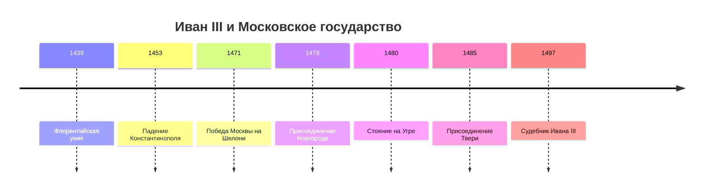

> [!abstract]+ 🎯 План лекции
> 1. Контекст XV века: падение Константинополя и положение Русской церкви.
> 2. Объединение Новгорода, Твери и других земель при Иване III.
> 3. Конец ордынской зависимости, Судебник 1497 года и строительство Кремля.

## 1. Контекст: что происходило вокруг (середина–конец XV в.)

- **1453 г. — Падение Константинополя.** Турки-османы захватили Византию. Конец византийской эпохи.
    
- **1439 г. — Флорентийская уния.** Греки попытались объединиться с католиками (Папой Римским), чтобы спастись. На Руси это посчитали предательством православия. В итоге Русская церковь стала автокефальной (самостоятельной) и начала ставить митрополитов сама.
    
- **Идея «Москва — Третий Рим»:**
    
    - 1-й Рим пал от варваров.
        
    - 2-й Рим (Царьград) пал от турок из-за унии/грехов.
        
    - 3-й Рим — Москва («а четвёртому не бывать»). Русь теперь — единственный оплот истинной веры.
        
- **1492 г. (7000 год от ств. мира):** ждали конец света (в Европе в это время Колумб открывает Америку).
    

## 2. Объединение земель вокруг Москвы (Иван III: 1462–1505)

### Новгород (1471, 1478)

- Новгород был республикой, правил боярский совет (вече), смотрел на Запад (Ганза).
    
- **1471** — Битва на реке Шелони (Москва разбила новгородцев).
    
- **1478** — Полное присоединение. Вечевой колокол сняли и увезли в Москву, вече отменили, часть бояр расселили.
    

### Тверь (1485)

- Главный давний соперник Москвы. Тверской князь пытался сбежать под союз с Литвой, но Иван III быстро забрал Тверь себе.
    

### Вятка и Пермский край

- Присоединили ради пушнины и контроля над Уралом.
    

## 3. Конец ордынского ига

- **1480 г. — Стояние на реке Угре:**
    
    - Иван III против хана Ахмата.
        
    - Постояли друг напротив друга у реки, постреляли, ордынцы развернулись и ушли.
        
    - **Итог:** Дани больше нет. Ордынское иго окончательно пало. Русь — независимое государство.
        

## 4. Законы и власть

- **Судебник 1497 г.:** Первый единый законопроект со времён Древней Руси.
    
    - Появился **Юрьев день** (26 ноября) — уйти от хозяина крестьянин мог только за неделю до и неделю после этого дня (+ платили «пожилое»). Начало закрепощения.
        
- **Женитьба на Софье Палеолог (1472):**
    
    - Она племянница последнего византийского императора.
        
    - Из Византии переняли герб — **двуглавого орла**, и титул **«Государь всея Руси»**.
        

## 5. Строительство Кремля и архитектура

- Софья привезла с собой итальянских мастеров (в Италии тогда эпоха Возрождения).
    
- **Аристотель Фиораванти:**
    
    - Привёз чертежи, циркуль, линейку («правило и кружал») и нормальный кирпич.
        
    - Построил **Успенский собор (1475–1479)** — за основу взял собор во Владимире. Главный храм для венчания на царство.
        
- **Новый Кремль:** Заменили старый белокаменный (который уже сыпался) на современный краснокирпичный как военную крепость.
    
- **Архангельский собор:** Стал усыпальницей московских князей и царей.
    

## 🗓️ Хронология

| Год | Событие |
|---|---|
| 1439 | Флорентийская уния |
| 1453 | Падение Константинополя |
| 1471, 1478 | Победа на Шелони и присоединение Новгорода |
| 1480 | Стояние на Угре |
| 1485 | Присоединение Твери |
| 1497 | Судебник Ивана III |

## 🗂️ Сводка

- При Иване III территория Московского государства значительно выросла: присоединились Новгород, Тверь и другие земли.
- После стояния на Угре прекратилась ордынская зависимость; Судебник 1497 года объединил правовые нормы.
- Был построен новый кирпичный Кремль. Василий III продолжил объединение (Псков, Смоленск, Рязань) и передал Ивану IV крупное единое государство.

## 📖 Термины

- **Автокефалия** — самостоятельность Русской церкви в поставлении митрополитов.
- **Судебник 1497 года** — единый свод законов времени Ивана III.
- **Юрьев день** — установленный Судебником период перехода крестьянина от хозяина к хозяину с уплатой «пожилого».

## ✅ Что проверить

> [!question]- ✅ Вопросы к лекции
> - [ ] Почему после Флорентийской унии Русская церковь стала самостоятельной?
> - [ ] Как и когда к Москве присоединились Новгород и Тверь?
> - [ ] Что произошло на Угре в 1480 году?
> - [ ] Что изменил Судебник 1497 года для крестьян?
> - [ ] Какие постройки Кремля связаны с правлением Ивана III?
