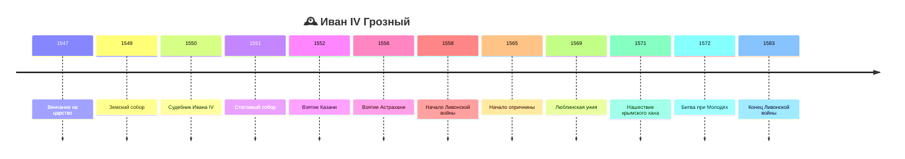

> [!abstract]+ 🎯 План лекции
> 1. 👥 **Избранная рада** и переписка с Курбским
> 2. 🏛️ **Реформы 1550-х годов:** Земский собор, стрелецкое войско, Судебник 1550, налоги для монастырей, Стоглавый собор, приказная система
> 3. 🌍 **Внешняя политика:** Казань, Астрахань, Сибирь, Крым, Ливонская война
> 4. 🩸 **Опричнина** (1565) и её причины

> [!info] 🔗 Связь с прошлой лекцией
> Продолжение темы [[05.10.26 — Иван III и создание Московского централизованного государства]]: при Иване III были заложены основы управления огромной территорией, при Иване IV они оформляются окончательно.

## 👥 1. Избранная рада

> [!important] 🧭 Новые векторы развития
> Реформы 1550-х годов дали России **абсолютно новые векторы развития**. Одним из ключевых сюжетов стала **Избранная рада** — круг ближайших единомышленников молодого царя.

- Иван **реально прислушивался** к ним, обращался за советом, они вместе обсуждали важнейшие вопросы
- Это были **молодые люди**: в **1547** году Ивану было **17 лет**, в **1550** — **20 лет**
- Молодому правителю, которому «вложили в голову, что он самый-самый», нужны были люди, которым можно **открыться** и **посоветоваться**
- Постепенно Иван всё больше шёл по другому вектору: **«Я самый лучший, я за всех отвечаю, а остальные ничего не знают и только мешают»**

> [!warning] 📉 Судьба Избранной рады
> Рада **себя изжила**. Многих её членов **убрали**, **казнили** или они **бежали за границу**.

---

## ✉️ 2. Курбский и Грозный

> [!example] 🏃 Андрей Курбский
> - Первый русский **политический эмигрант**
> - Сначала — **ближайший сподвижник** Ивана: знатный, богатый, умелый воин, огромный авторитет для молодого царя
> - Но по мере усиления подозрительности «пробежала кошка», и Курбский **не стал дожидаться казни**, а **бежал в Литву**, затем в Польшу

### 📜 Переписка
До наших дней сохранилась **переписка Курбского и Ивана Грозного**:

| Кто | Содержание |
|---|---|
| ✍️ **Грозный** | «Мы тебе всё дали, поддерживали, слушали, а ты бежал и поливаешь нашу власть грязью» |
| ✍️ **Курбский** | «Вспомни, каким ты был и какие планы мы обсуждали. Ты **казнил всех друзей**, **утопил страну в крови**. Я не вернусь» |

> [!tip] 🧠 Важный момент
> Иван Грозный **не был безграмотным**: он **сам писал эти письма**. Это **литературный памятник эпохи**: можно читать не через учебник, а через **образ Ивана в письмах**. Он в чём-то может лукавить (как в любом письме), но видно, **почему он поступает так, как поступает**.
>
> Он считает себя **царём, ответственным за Россию и за народ**, и что **перед Богом за всё ответит сам**.

---

## 🏛️ 3. Земский собор

### ❓ Зачем он нужен
> [!question] 🤔 Против кого создавался?
> Против **бояр**. **Боярская дума** была оппозиционна Ивану: богатые, авторитетные, властные — но **люто его ненавидели**, потому что он стал царём. Вынуждены кланяться и подчиняться, власть признают божественной, но лично ненавидят.
>
> Ивану нужна **опора во власти**: «меня поддерживают представители всех сословий».

### 🧩 Статус
- По статусу — **совещательный**, **представительный** орган сословий
- **Не парламент** в европейском смысле (во Франции парламент, в Англии парламент с XV века)
- Первый слабый **опыт сословного представительства**
- На деле участникам **давали готовые решения** — они **кивали** согласно воле царя; поддерживали Ивана, получая подарки, земли, деньги

### ⚖️ Как работал

> [!success] ⚖️ Итог
> Земский собор — **противовес Боярской думе**. Со временем Дума теряла функции, а собор **перетягивал** функции совещательного органа. После репрессий Ивана Боярская дума даже **численно** не собиралась в прежнем составе (середины XVI в.). Но цари оставались **абсолютными**.

---

## 🎖️ 4. Военная реформа: стрельцы

> [!important] 🔫 Создано стрелецкое войско
> Внешняя политика Ивана была **успешной**: побеждены Астраханское и Казанское ханства, Сибирское ханство, Ливонская война на первом этапе успешна. Без хорошей армии это невозможно.

Ивану нужна **новая армия**, которая:
- **подчиняется ему** и слушает его (никаких бояр-местников)
- **хорошо вооружена**
- может выполнять разные задачи

### 🔫 Стрельцы
- **Профессиональные военные**: не торгуют и не пашут землю, занимаются только военным делом
- Название — от слова «стрелять»: вооружены **огнестрельным оружием (мушкетами)**
- Впервые в русской армии **специальное подразделение**, а не просто артиллерия
- Раньше служилые люди **покупали снаряжение за свой счёт** и зависели от местничества; мушкет простой ремесленник не сделает — нужна **государственная рука** (централизованное производство или закупка и вооружение)
- Стрельцы стали **основой войска Ивана Грозного**

> [!note] 🎬 Про кино
> В фильмах стрельцы часто с алебардами и бердышами: это условный образ. По смыслу стрелец — тот, кто **стреляет из мушкета** (аналогия: мушкетёры Дюма).

---

## ⚖️ 5. Судебник 1550 года

- Прошло **53 года** после Судебника Ивана III (1497), и создаётся **новый**, теперь уже внуком — **Иваном IV**
- Жизнь стала **быстрее и сложнее**: появилось **социальное расслоение**, имущественные вопросы усложнились, их нужно регулировать

> [!tip] 🔄 Разница с Иваном III
> Иван III дал Судебник **в конце правления**, обозначив уже **произошедшие процессы**. Иван IV наоборот: пришёл к власти в **1547**, а в **1550** уже даёт новый Судебник. Это результат подготовки: **Избранная рада** подсказывала: «Иван Васильевич, Русь так дальше не может, надо организовывать».

Судебник **по-новому** заставил Русь жить в плане нормативной базы.

---

## ⛪ 6. Церковная реформа и налоги для монастырей

### 💰 Налоги для монастырей
- Ранее на семинарах: Иван III пытался ограничить церковные владения, но отказался
- Иван Грозный смотрит на церковное имущество как на **ресурс, резерв**
- Землю не отбирает (воспитывался **Макарием** и **Сильвестром**, которые венчали его на царство), но **облагает монастыри налогом**: «платите по тем налогам, что и все, государству нужны деньги»
- **Деньги нужны:** на стрелецкое войско (вооружать, содержать, кормить)
- Другие налоги тоже увеличили, чтобы покрывать расходы государства

### 📖 Стоглавый собор (1551)
> [!info] 🕍 Что это
> **Всероссийский церковный собор**: съехались представители крупных монастырей, верховные иерархи. Итоговый документ — книга из **100 глав** (поэтому «Стоглав»), а «Стоглавый собор» — устоявшийся термин, хотя и не совсем точный.

**Зачем:**
- церковь играла важную роль, но были **злоупотребления**: священники вели себя неподобающе, пили, поднимали руку на монахов, при этом проповедовали нравственность
- светская власть в церковь **не вмешивалась**, и это сыграло с церковью злую шутку

**Что решили:**
- кто **будет святым на Руси** (в разных регионах — разные почитаемые святые, нужен единый перечень)
- **стандартизация** служб и обрядов
- **единая система судов** для церквей
- **усиление контроля государства** над церковью

> [!quote] 💬 Позиция Ивана
> Иван IV **искренне верил**, был глубоко религиозен, считал себя имеющим **божественное предназначение**. Церкви многое дал, но и **поставил её под свой контроль**, несмотря на всю жестокость.

---

## 🗂️ 7. Государственная реформа: приказная система

### ✂️ Отмена кормлений
- **Кормления** — содержание чиновника за счёт населения (он «выкачивал последнее»)
- При Иване III кормления помогали **укрепить власть на местах**; при Иване IV стали **тормозом** ➜ **отменены**
- Попытка создать **административно-территориальную реформу на местах**: земские и губные старосты

> [!warning] ⚠️ Главная проблема России
> **Слабая власть на местах**: мало чиновников, огромные территории. Москва и окрестности — «на ручном управлении», чем дальше в глубинку, тем хуже. Воровство, тяжбы, неправедные решения, взятки («я заплачу больше — суди в мою пользу»).
>
> **Сравнение:** Екатерина II поняла, что сильная власть должна быть не только в Петербурге, и начала дробить страну на **губернии** с чиновничьим аппаратом. Это усилило власть, но и **бюрократию** (отсюда сатира XIX в.).

### 🧱 Схема власти
**Царь — Боярская дума — приказы**, плюс **Земский собор** как совещательный орган и противовес боярам.

### 📋 Приказы: три контура
| Контур | Приказы | Чем занимались |
|---|---|---|
| 👑 **Дворцовые** | дворец, казна, сокольничий, постельничий | двор, охота, быт, хозяйство |
| 🏢 **Отраслевые** (центральные, «министерства») | Посольский, Разрядный, Поместный, Стрелецкий, Пушкарский, Разбойный, Челобитный | см. ниже |
| 🗺️ **Территориальные** | по Сибири, Казани, Астрахани | военная администрация новых земель, где ещё не действуют общие нормы |

### 🏢 Отраслевые приказы
- 🌍 **Посольский** — «МИД»: приём послов, отправка делегаций, нужны знания языков и этикета
- 📋 **Разрядный** — должности и **местничество**: кто какой пост занимает, кто наследует при смерти
- 🏘️ **Поместный** — земля, служба, кому что принадлежит, откуда налоги
- 🔫 **Стрелецкий** — подготовка, обеспечение, планирование военных мероприятий
- 💣 **Пушкарский** — не только стрельба из пушек, но и **горнодобывающая отрасль**: где брать металл, где лить чугун, ядра, пушки
- 🚔 **Разбойный** — «МВД»: преступления, поиск, тюрьмы
- ✉️ **Челобитный** — жалобы населения (могут быть и анонимки, и важные сигналы; важные передавались в Разбойный и другие приказы)

> [!success] 🎓 Значение
> Система приказов — **дневная модель** управления, позволяющая «не заниматься всем подряд»: появляется **специализация** (в Посольском нужны иностранные языки, в Разбойном своя специфика).

> [!tip] 🧠 Общая мысль
> Судебная, военная, административная и церковная реформы затронули **все базовые отрасли за очень короткий период**. Часто **сильная страна внутри = сильная внешняя политика**, а кризис внутри = слабая внешняя. У Ивана так и вышло: **сильная внутренняя политика — успешная внешняя; упадок внутри — поражение вовне**.

---

## 🌍 8. Внешняя политика

### 🗺️ Карта Европы XVI века
| Сторона | Игрок |
|---|---|
| 🏰 **Юг** | **Османская империя** |
| 🏰 **Запад** | **Великое княжество Литовское** и **Польша** (позже в середине XVI в. объединятся в **Речь Посполитую**, главного конкурента России на западных границах) |
| 🏰 **Север** | **Швеция** (включая территорию Финляндии) |
| 🏰 **Дальний запад** | Англия, Франция, Испания |

> [!info] 🏙️ Москва XVI века
> Границы города примерно по **Садовому кольцу**: Тверские, Никитские, Арбатские ворота — сегодня просто названия станций метро. Дороги из Москвы расходились через эти ворота.

### ➡️ Направления внешней политики
Земли, вошедшие при Иване III и Василии III (в том числе частично Левобережная Украина и Смоленск), **теперь окрашены одним цветом — это Русь XVI века**.

| Направление | Итог |
|---|---|
| 🏰 **Казанское ханство** (средняя Волга) | ✅ **1552** — взято |
| 🏰 **Астраханское ханство** (нижняя Волга) | ✅ **1556** — взято |
| 🏰 **Сибирское ханство** | ✅ включено в состав |
| 🏰 **Крымское ханство** | ❌ **постоянная угроза** южной границе |
| 🏰 **Балтика (Ливония)** | ⚔️ Ливонская война |

> [!danger] 🔥 Крымский хан
> В **1571** году крымский хан **практически уничтожил русскую государственность**: Иван бежал из Москвы. Благодаря героизму русских военачальников хан был остановлен и отбит (**битва при Молодях, 1572**). Но Крым оставался серьёзнейшим противником.

> [!warning] 🌊 Выход к морю
> У России был ограниченный выход к морю, **порта на Балтике не было**: после неудач в Ливонии Россию «выдавили», и она была вынуждена торговать **только через Архангельск**.

---

## ⚔️ 9. Ливонская война

> [!info] 📅 Хронология
> **1558–1583**. В начале 1550-х взяты Казань и Астрахань, затем — Ливония.

### 🥇 Первый этап: успех
- Противник — **Ливонский орден** (когда-то могущественный, с которым воевал Александр Невский; к XVI в. слабый и без войска)
- Иван Грозный захватывает **крепости, укрепляется в Прибалтике**, кажется, что всё идёт как надо

### 🩸 Перелом: опричнина
С **1565** года начинается **опричнина**:
- террор, казни, пытки, разгром
- **смена и казнь многих военачальников**
- страна в состоянии **экономического коллапса** не могла вести успешную войну

### 🇵🇱 Второй этап: Речь Посполитая
- Россия подтолкнула соседей к объединению: в **1569** году заключена **Люблинская уния** — Польша и Литва объединяются в **Речь Посполитую**
- Теперь против России — **хорошо обученная польская армия**, понимающая цель: **выдавить Россию из Прибалтики**, чтобы не появился сильный конкурент
- Вторая часть войны — уже **русско-польская война**, Польша одерживает ряд побед и заставляет Россию отказаться от приобретений

### 📊 Итог (**1583**)
> [!question] 🏁 Проиграла ли Россия?
> - Формально — **проиграла**: завоёванное на первом этапе потеряла
> - Но **старых земель не потеряла**: вернулась к исходной позиции
> - Главная проблема не территориальная, а в том, что война **подтолкнула Польшу и Литву к объединению**, и Речь Посполитая надолго стала главным конкурентом на западе

---

## 🩸 10. Опричнина

> [!danger] 💀 «Та самая причина главного упрёка Ивану IV»

### 🧠 Почему Иван стал таким (версии)
- **Смерть жены**: она «психологически спасала» его, а после её смерти никто не мог упрекнуть «по-человечески»
- **Мессианское видение** собственной роли, усилившееся с годами
- Сложная **психика** (диагноза нет, но нормальный человек, вероятно, так не поступал)

### 🎯 Цели
> [!important] 🏛️ Главная цель
> Опричнина должна была создать систему, где **власть царя ничем и никем не ограничена**. Основной удар — по **боярам**.

- Иван добился желаемого: бояре **уничтожены или надолго замолчали** и во всём поддерживали царя
- Попутно — **полные разгромы** усадеб, **разгром Новгорода**
- **Опричники** действовали без моральных ограничений: задача — «кровью и железом» навести **страх и ужас** и нанести **экономический ущерб**

> [!tip] 🔎 Современный взгляд
> Раньше опричнина оценивалась исключительно **негативно**. Сейчас в исследованиях пытаются **переосмыслить образ Ивана** и объяснить, **почему опричнина всё-таки произошла**. Подробнее — на семинарах и в приложенных материалах (см. последний абзац).

> [!note] 🎬 Кино
> Образ Ивана Грозного — фильм Сергея Эйзенштейна с **Николаем Черкасовым** в главной роли (он же сыграл Александра Невского).

---

## 🗓️ Хронология

| 📅 Год | 📌 Событие |
|---|---|
| **1547** | Иван IV венчан на царство (17 лет) |
| **1550** | Судебник Ивана IV |
| **1551** | Стоглавый собор |
| **1552** | Взятие Казани |
| **1556** | Взятие Астрахани |
| **1558** | Начало Ливонской войны |
| **1565** | Начало опричнины |
| **1569** | Люблинская уния, Речь Посполитая |
| **1571** | Нашествие крымского хана, Иван бежал из Москвы |
| **1572** | Битва при Молодях |
| **1583** | Конец Ливонской войны |

---

## 🗂️ Сводка

- Реформы 1550-х годов при Иване IV затронули представительство, армию, суд, церковь и центральное управление.
- Взятие Казани и Астрахани расширило государство; Ливонская война завершилась без выхода к Балтийскому морю.
- Опричнина 1565 года сопровождалась террором и разорением земель.

---

## 👤 Персоналии

| 🎭 Персона | Ключевое |
|---|---|
| 👑 **Иван IV Грозный** | Первый русский царь, реформатор и автор опричнины |
| 👥 **Избранная рада** | Круг молодых советников царя |
| 🏃 **Андрей Курбский** | Бывший сподвижник, бежал в Литву; переписка с Грозным |
| ⛪ **Макарий, Сильвестр** | Духовные наставники, венчали на царство |
| 🎬 **Николай Черкасов** | Исполнитель роли Грозного в фильме Эйзенштейна |

---

## 📖 Термины

- 👥 **Избранная рада** — круг ближайших советников молодого Ивана IV
- 🏛️ **Земский собор** — сословно-представительный орган при царе
- 🔫 **Стрельцы** — профессиональное войско, вооружённое огнестрельным оружием
- 📖 **Стоглавый собор** — церковный собор, итоговая книга из 100 глав
- 🍞 **Кормления** — содержание чиновников за счёт населения
- 🗂️ **Приказы** — центральные органы управления («министерства»)
- 📋 **Разрядный приказ** — ведал должностями и местничеством
- 🩸 **Опричнина** — система террора и особого управления с 1565 года
- 🇵🇱 **Речь Посполитая** — объединённое государство Польши и Литвы (1569)
- 🏛️ **Люблинская уния** — акт объединения Польши и Литвы

---

## ✅ Что проверить

> [!question]- ✅ Вопросы к лекции
> - [ ] Что такое Избранная рада и как она закончила?
> - [ ] Что было в переписке Грозного и Курбского?
> - [ ] Зачем создавался Земский собор и против кого?
> - [ ] Почему стрельцы — новый тип войска?
> - [ ] Чем Судебник 1550 года отличается от Судебника 1497 года по обстоятельствам создания?
> - [ ] Что решил Стоглавый собор?
> - [ ] Что такое кормления и почему их отменили?
> - [ ] Какие три контура приказной системы?
> - [ ] Чем закончилась Ливонская война? Что такое Люблинская уния?
> - [ ] Что такое опричнина, какова её цель?

> [!todo] ✅ Что дополнить
> - [ ] Начало лекции (детство Ивана, венчание на царство 1547, Макарий, Сильвестр) в записи отсутствует, добавить по презентации
> - [ ] На семинарах будет разбор опричнины и последнего абзаца методички
