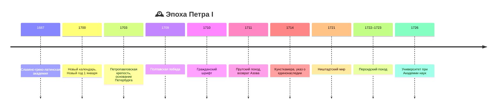

# Пётр I: внешняя политика и реформы образования, науки и культуры

> [!abstract]+ 🎯 О чём лекция
> 1. 🌊 **Итоги Северной войны:** Ништадтский мир 1721 года
> 2. 🧭 **Южный вектор:** Азовские походы, Прутский поход, поход против Персии
> 3. 🔄 **Петровские реформы** в целом: взаимосвязь, результативность
> 4. 📚 **Образование, наука, культура:** календарь, школы, стажировки, шрифт, газета, Академия наук
> 5. 🎭 **Быт и нравы:** ассамблеи, женский мир, Всешутейший собор
> 6. 🏛️ **Санкт-Петербург:** Петропавловская крепость, архитектура, Кунсткамера

## 📑 Оглавление
- [[#🌊 1. Итоги Северной войны]]
- [[#🧭 2. Южный вектор внешней политики]]
- [[#🔄 3. Петровские реформы в целом]]
- [[#📚 4. Реформы образования, науки, культуры]]
- [[#🎭 5. Ассамблеи и женский мир]]
- [[#🍷 6. Всешутейший собор]]
- [[#🏛️ 7. Санкт-Петербург и архитектура]]
- [[#🗓️ Хронология]] · [[#👤 Персоналии]] · [[#📖 Термины]] · [[#🧠 Самопроверка]]

---

## 🌊 1. Итоги Северной войны

> [!info] 📅 **1721 год** — Ништадтский мир
> Закрепил успехи России в Северной войне.

### 🗺️ Территориальные приобретения
- **Земли в Прибалтике**
- **Земли в районе Ладоги и устья Невы** (когда-то были за Россией, потеряны после Смутного времени, теперь возвращены)
- В ходе войны русские войска **заняли Финляндию**, но по условиям мира **вернули её Швеции**

> [!note] 🤝 Не капитуляция
> Шведы оставались **достаточно сильным государством**. Заключение мира шло долго: торговались, что оставляют и что отдают, какие платежи. Швеция понимала, что война проиграна, а России важно было закрепить Прибалтику.

### 🇫🇮 Дальнейшая судьба Финляндии
- В начале XIX века (после наполеоновских войн) Финляндия **вошла в состав России** (1809), присоединение закрепил **Венский конгресс** (1815)
- До **1917 года** Финляндия **не была непосредственно частью российских губерний**, со своей спецификой управления

### 👑 Итог для России
> [!success] 🏆 Европейская супердержава
> - Россия вышла на **Балтийское побережье**
> - **Швеция вылетела из «высшего дивизиона»** европейских супердержав (Франция, Швеция, Великобритания, Польша приходила в упадок) на рубеже XVII–XVIII вв.
> - На северо-востоке Европы место Швеции заняла **Россия**

---

## 🧭 2. Южный вектор внешней политики

> [!info] 📊 Три направления (по слайду)
> 1. **Южное**
> 2. **Юго-западное**
> 3. **Северо-западное** (Северная война)

Пётр изначально планировал борьбу за **южные рубежи**: выход к **Чёрному и Азовскому морям**. Азовские походы полностью в свою пользу перевернуть не удалось, и Пётр переключился на север. Но южное направление не исчезло: пока шла Северная война, армия **продолжала пытать счастья на юге**.

### 🏛️ Поход против Персии
- Оказался **достаточно успешным** (1722–1723)
- Россия **прочно встала на берегах Каспийского моря**
- Стало плацдармом для дальнейшего продвижения за Кавказ: в эпоху Екатерины Грузия перейдёт в протекторат, затем армянские и азербайджанские территории
- Пётр в плане территориальной экспансии был «очень жадный, аппетит хороший»

### ⚔️ Прутский поход против Турции (1711)
> [!danger] 💥 Сокрушительное поражение
> Поход стал продолжением кампании против Швеции: после **Полтавы (1709)** и победы над Карлом XII шведская армия на суше уже не угрожала, и Пётр решил закрепиться на юге.

**Причины провала:**
- **Импульсивность Петра**, неподготовленность: «получилось тут — значит, и дальше победный марш»
- Армия **оторвалась от продовольственных и вооружённых баз**, не продумали тягловую силу
- Война с Турцией и Крымом **в летнюю жару, в безводной причерноморской степи** — тяжёлое испытание

**Итоги:**
- Русская армия потерпела **сокрушительное поражение**, Пётр **едва не попал в плен**
- Мир заключили, армию **разблокировали**
- **Азов пришлось вернуть Турции**, а построенные на Азове крепости **срыть**
- Пётр окончательно **перенацелился на северный театр** («якорёк, брошенный в конце XVII в., пришлось поднять»)

---

## 🔄 3. Петровские реформы в целом

- Реформы **тесно переплетены**: экономика ↔ армия ↔ управление; невозможно выделить «важные» и «неважные»
- Затронули **практически все сферы** государства; эпоха стоит **особняком** по масштабу за короткий срок

> [!question] ❓ Вопросы для размышления
> - Насколько они были **результативны**?
> - В каком объёме **нужны**?
> - Насколько **планировались**? (импульсивность, незавершённость)

> [!success] 🏛️ Итог
> Реформы заложили **основу новой России**: на протяжении всего XVIII и XIX веков мы имеем дело с **петровской моделью** — в армии, управлении и экономике.

> [!tip] 🎯 Почему упор на образование
> Реформы в экономике и управлении были и раньше (Иван III, Иван IV). Но Пётр **кардинально поменял культурно-традиционные устои** общества. Образование, наука и культура — как «ядро и периферия» в структуре атома: часть реформ центральные, часть — дополнительные свойства.

---

## 📚 4. Реформы образования, науки, культуры

### 📅 4.1. Новое летоисчисление
> [!important] 🗓️ С **1 января 1700 года**
> - До этого Русь жила по **летоисчислению от сотворения мира** (7208 год и т. д.) и **Новый год начинался 1 сентября**
> - Пётр вводит **юлианский календарь от Рождества Христова** и переносит Новый год на **1 января**, чтобы приобщить Россию к европейскому миру
> - Дальше календарь лишь редактируется (старый и новый стиль), но хронология годов остаётся той же

**Как это восприняли:** «Зачем? Кому мешало старое?» Путаница с датами рождения, документами, договорами.

**Новогодние традиции:** приказывали **украшать ёлки**, устраивать салюты, праздновать по европейской традиции. На Руси в конце года были **рождественские праздники**, которые теперь **совпали с новогодними**. Ни Деда Мороза, ни санок-снежков «в нынешнем смысле» тогда не было; Дед Мороз появится гораздо позже.

> [!note] 🌍 Результат
> Для народа — путаница. Но Россия **совпала в календарных датах с Европой**.

### 🎓 4.2. Система образования

#### 📉 До Петра
- Раньше на Руси грамотность была высокой (берестяные грамоты), потом возникла **«лакуна»**: образование стало доступным узкому слою, в основном **монахам**
- Профессиональных школ и училищ не было, максимум **домашнее образование**
- При **Алексее Михайловиче** (XVII в.) жизнь усложняется ➜ появляются **первые буквари**, первые **народные школы**, учебники арифметики и грамматики

#### 🏛️ Славяно-греко-латинская академия (**1687**)
- **Первое высшее учебное заведение** в Москве, готовило кадры для госорганов, в частности для **Посольского приказа**
- Нужны были люди, знающие **латынь** (язык европейской дипломатии и науки); на Руси латынь считалась «вражеской» католической
- Уже до Петра видны **прозападные тенденции**, Пётр их **«уложил на рельсы»**

#### 🎯 Что нужно Петру
> [!important] 🛠️ Практики, а не теоретики
> Не знатоки античной истории и не толкователи Библии, а **офицеры, инженеры, артиллеристы, врачи, моряки** (навигация). Школы — **профессиональные**, под конкретную цель.

### 🧳 4.3. Зарубежные стажировки
- Дворянских и боярских детей **отправляли учиться за границу**: осваивать науки, овладевать практикой

> [!question] 🤔 Как к этому относились?
> **Негативно.** Причины:
> - Дворянину светила **расписанная жизнь**: наследство, чин по рождению, богатая свадьба, дом
> - Пётр **вводит указ о единонаследии (1714)**: имение передаётся **одному сыну**, остальные должны **идти служить и работать**
> - **Запрет жениться**, пока не получил образование и не состоишь на службе
> - Незнакомая культура, религия, еда, климат, язык; по возвращении **спрашивали за результат**, ведь «деньги заплатили»
> - Сохранились письма: **«папенька, забери нас обратно»**
>
> Были и те, кому было **интересно** (дети из Посольского приказа, общавшиеся с иностранцами; кому «модно быть в фарватере» Петра). По оценке лектора, **~1/5 хотели, 4/5 нет**.

> [!warning] 🧱 Сенат и бояре
> Пётр ослаблял влияние бояр: **Сенат** — это 10–12 **назначенных им единомышленников**, а не Боярская дума. Сенат лишь придавал решениям видимость коллективной воли.

Набор в школы тоже был **силовым**: «ты туда, ты туда, ты в артиллерийскую школу, дальше посмотрим».

### 👩‍🏫 4.4. Кадры и книги
- **Преподавателей-иностранцев** выписывали для всех школ; они **читали курсы не по-русски**
- Русский язык был **очень тяжёлым**: основан на церковнославянском, длинные синтаксические конструкции, множество устаревших слов, много букв с разным чтением

> [!success] ✍️ Гражданский шрифт (**1710**)
> - **Упрощённый шрифт**: меньше букв, меньше «несоответствий» буквы и звука
> - Упрощается обучение и **печать книг**, люди быстрее учатся читать
> - Школы открыли раньше, шрифт ввели позже: сначала выяснилось, что **по старым учебникам никто ничего не понимает**

**Зачем это Петру:** он писал **воинский и морской уставы**; чтобы ими пользовались, офицеры должны уметь **читать** и знать уставы почти наизусть. Реформы образования, управления и армии **переплетены**.

### 📰 4.5. Печать, газета, Академия наук
- Печатаются **учебники и справочники**: грамматики, арифметики, астрономии, навигации, медицины ➜ ценится **профессиональное образование**
- **Первая газета** («Ведомости»): Пётр сам редактировал первые номера, определял, что включать. Газеты стали основным официальным информационным каналом (особенно в Петербурге)
- **Академия наук:** «академию создали, а академиков ещё не было». Первые академики — **иностранные специалисты**, привлечённые окладами и условиями; многие чужды русской культуре. Через несколько десятилетий после смерти Петра работа Академии налаживается

> [!info] 🏛️ Первый университет
> Номинально первый университет создан **при Академии наук (1726)**, но не было стройной системы набора, обучения и выпуска. Настоящая система — **Московский университет** (середина XVIII в.).
>
> **Эволюция:** Славяно-греко-латинская академия ➜ университет при Академии наук ➜ **Московский университет (МГУ)**.

---

## 🎭 5. Ассамблеи и женский мир

### 🥂 Ассамблеи
> [!important] 💡 Идея
> Пётр за границей видел **европейские дворы** (Вена, Париж, Голландия, Лондон): светские беседы о культуре, политике и экономике, закуски, развлечения. Он хотел так же у себя: **вывести дворян из домашнего уединения** и приучить к европейской культуре.

- Раньше: стемнело ➜ двери закрыли, свечка, спать. Теперь: **«жизнь только начинается»**
- Ассамблея — вечер у дворянина; **хозяин всё организует за свой счёт** (музыка, напитки, закуски, развлечения): «хочешь быть в элитарном клубе — соответствуй». Бывали у Меншикова, Голицына, Апраксина, Головина
- Ассамблеи **цементировали петровское сообщество**; неявка воспринималась как игнор или болезнь

> [!warning] 💸 Реакция
> Накладно, брали в долг, надеясь на поощрение. Пока Пётр был в Москве, ассамблеи шли; **когда он переехал в Петербург, московские ассамблеи угасли**, без него их «спускали на тормозах».

> [!tip] 🕰️ Что осталось
> Через несколько десятков лет **русские балы, театр, балет** (XIX в.), у Толстого в «Войне и мире» — этикет, танцы, регламент. Это начало: Пётр **силой заставлял полюбить западные ценности**.

### 👗 Женский мир
- До Петра женщина — **дети, семья, церковь**, «хранительница очага», у богатых — **женская половина** («терем»), никакой светской жизни
- Пётр **распахнул двери**: видел за границей женщину **в центре внимания** (одета, знает языки, музицирует, поддерживает беседу) и **требует от бояр**, чтобы жёны были такими же
- **Хозяйка обязана присутствовать** на вечере; платья, внешний вид, общение
- Менялся уклад: одно дело сменить кафтан, другое — менталитет
- Итог: женский мир выглядит **по-другому**, и позже **женщины на престоле практически весь XVIII век**

---

## 🍷 6. Всешутейший собор

> [!danger] 🍾 «Всешутейший, всепьянейший и сумасброднейший собор»
> Элитарный клуб ближайших соратников Петра (Шеин, Ромодановский, Апраксин, Меншиков и др.). Здесь, в отличие от ассамблей, нет «цивилизованной цели»: **собирались, чтобы напиваться**.

### 🎪 Структура и нравы
- Шуточные **церковные титулы:** «**князь-папа**» (намёк на католицизм), «**князь-кесарь**», архиепископы, игумены; у всех **шутливые и непристойные прозвища** (В. О. Ключевский заметил, что они не пройдут ни в какую цензуру)
- Выборы «папы»: чаша с вином, из которой надо было пить; **отказаться или не участвовать нельзя** (Пётр сам участвовал)
- **Пародии на крестные ходы**
- Запряжённые **ослы, свиньи, медведи**, шубы наизнанку; пьяная компания царя ехала по Москве с музыкой, криками

### 🤔 Зачем?
- Кто-то видит цель **подорвать авторитет церкви**; кто-то объясняет иначе
- Если бы всё было «тихо и у себя», никто бы слова не сказал; но делалось **на показ**
- Вопрос остаётся: **зачем** ломать русские традиции

> [!warning] ⛪ Реакция
> Москвичи: «что происходит в стране?». Добавлялись **календарь, насмешки над церковью, пьянки**. Утверждение **«царь — Антихрист»** воспринималось как подтверждённое. **Старообрядческий дух усилился:** люди бежали на **Урал и север**, в **раскольничьи скиты** (от налогов, повинностей и из-за неприятия новой культуры).

### 😄 Культура смеха
> [!note] 🎭 Новое явление
> Впервые при Петре на Руси появляется **«культура смеха»**: вульгарная, но воспринимаемая как **игра, пародия, юмор**. Русская культура до этого очень серьёзная и трагичная, зациклена на религиозных ценностях (распятие, мученики, нравственность). В Европе уже давно были «Гаргантюа и Пантагрюэль» Рабле и комедии.
>
> **Алексей Михайлович** любил театр, но **камерно** (маленький театр, 2–3 приближённых); **Пётр выносит развлечения «на показ»**: знать начинает развлекаться.

> [!tip] ⚖️ Не равнозначно
> Нельзя ставить на одну ступень указ о единонаследии и Всешутейший собор. Пётр рациональный реформатор, но и **ломал средневековый быт**. Без Всешутейшего собора портрет Петра **не полон**.

---

## 🏛️ 7. Санкт-Петербург и архитектура

### 🏰 Петропавловская крепость
- В начале Северной войны Пётр захватил шведскую крепость **Ниеншанц** на Неве
- Чтобы держать **устье Невы**, строится **Петропавловская крепость** на **Заячьем острове** (ближе к дельте Невы); **основана в 1703 г.**
- Образец **новых фортификационных технологий**: **бастионы по периметру острова**, с суши **кронверк** (враг сначала должен преодолеть его, затем переправляться через рукав Невы)
- С неё начинается развитие города

### 🗺️ Три участка города
- **Васильевский остров**
- **Петроградская сторона**
- Участок между **Мойкой и Фонтанкой** (позже Зимний дворец, Эрмитаж, Исаакиевский собор)
- **Мойка**, затем **Фонтанка** — естественные границы города на первых этапах

### ⛪ Символ и тюрьма
- **Петропавловский собор** — **усыпальница русских императоров** начиная с Петра
- Крепость — **политическая тюрьма** Российской империи

### 🏠 Гражданская архитектура
- **Зимний дворец Петра** не сохранился (современный — эпохи Елизаветы и Екатерины)
- **Летний дворец:** небольшой **двухэтажный дом**, никаких колонн и вычурности (летняя резиденция)
- Дворцы приближённых иногда **интереснее**, чем петровские
- Пётр был **прост в быту**, равнодушен к роскоши и золотой отделке; вдохновлялся западноевропейскими городами

### 🦴 Кунсткамера (**1714**)
> [!info] 🏛️ Начало музеев
> - До этого **музеев не было**: цари хранили в **Оружейной палате** драгоценности, оружие, трофеи
> - Пётр увидел за границей **естественно-научные кабинеты**: гербарии, чучела животных
> - **1714 год** — собрана первая Кунсткамера

---

## 🗓️ Хронология

| 📅 Год | 📌 Событие |
|---|---|
| **1687** | Славяно-греко-латинская академия |
| **1700** | Новое летоисчисление, Новый год 1 января |
| **1703** | Петропавловская крепость |
| **1709** | Полтавская победа |
| **1710** | Гражданский шрифт |
| **1711** | Прутский поход, Азов возвращён Турции |
| **1714** | Кунсткамера, указ о единонаследии |
| **1721** | Ништадтский мир |
| **1722–1723** | Персидский поход |
| **1726** | Университет при Академии наук |

---

## 👤 Персоналии

| 🎭 Персона | Ключевое |
|---|---|
| 👑 **Пётр I** | Реформатор, создатель империи и Петербурга |
| ⚔️ **Карл XII** | Шведский король, разбит под Полтавой |
| 👑 **Алексей Михайлович** | Отец Петра, первые школы и буквари, театр |
| 🎖️ **Меншиков, Апраксин, Голицын, Головин** | Соратники Петра, хозяева ассамблей |
| 🍷 **Ромодановский, Шеин** | Участники Всешутейшего собора |
| 📚 **Василий Ключевский** | Историк, о прозвищах Всешутейшего собора |

---

## 📖 Термины

- 🌊 **Ништадтский мир** — мир со Швецией (1721), итог Северной войны
- 📅 **Летоисчисление от сотворения мира** — старый русский календарь
- 🏛️ **Славяно-греко-латинская академия** — первое высшее учебное заведение (1687)
- ✍️ **Гражданский шрифт** — упрощённый шрифт (1710)
- 🥂 **Ассамблея** — светский вечер для дворян по европейскому образцу
- 🍷 **Всешутейший собор** — шутовская пьяная организация приближённых Петра
- 📜 **Указ о единонаследии** — имение передаётся одному сыну (1714)
- 🏛️ **Кунсткамера** — первый музей, «кабинет редкостей»
- 🏰 **Кронверк** — внешнее укрепление крепости со стороны суши
- 🔥 **Раскол** — старообрядческое неприятие реформ, бегство в скиты

---

## 🧠 Самопроверка

> [!question]- 🤔 Развернуть вопросы
> - [ ] Что по Ништадтскому миру получила Россия, а что вернула Швеции?
> - [ ] Что дало России присоединение Прикаспия?
> - [ ] Почему провалился Прутский поход и что потеряла Россия?
> - [ ] Как Пётр изменил календарь и Новый год? Как это восприняли?
> - [ ] Почему образование было нужно именно профессиональное?
> - [ ] Как дворяне относились к стажировкам за границей и почему?
> - [ ] Что такое гражданский шрифт и зачем он нужен?
> - [ ] Что представляли собой ассамблеи? Как изменился «женский мир»?
> - [ ] Что такое Всешутейший собор и как на него реагировало общество?
> - [ ] Какие объекты связаны с началом Санкт-Петербурга?

> [!todo] ✅ Для подготовки
> - [ ] Пересмотреть слайд «Основные направления внешней политики Петра» в презентации
> - [ ] Подготовиться к семинару по Петровским реформам
> - [ ] Связь с прошлой лекцией: Северная война, Полтавская битва, церковный раскол
