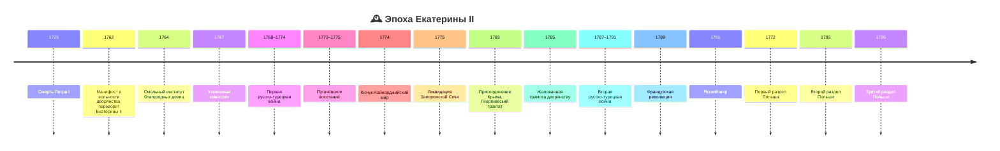

# Екатерина II: просвещённый абсолютизм, внутренняя и внешняя политика

> [!abstract]+ 🎯 О чём лекция
> 1. 👑 **Приход Екатерины к власти:** Елизавета, Пётр III, переворот 1762 года
> 2. 🖼️ **Портреты как исторический источник**
> 3. 📚 **Эпоха Просвещения** и **просвещённый абсолютизм**
> 4. 🏛️ **Внутренняя политика:** Уложенная комиссия, крепостное право, поворот 1775 года, Жалованная грамота дворянству 1785 года
> 5. 🔥 **Пугачёвское восстание**
> 6. 🌍 **Внешняя политика:** русско-турецкие войны, Крым, Грузия, разделы Польши

> [!info] 🔗 Связь с прошлой темой
> Продолжение лекции о дворцовых переворотах: четверть века между **смертью Петра I (1725)** и **воцарением Екатерины II (1762)**. Многие процессы, начатые при Петре, получили при Екатерине логическое завершение. Особенно **южный вектор**: Азовские походы Петра, походы Миниха и Ласси при Анне Иоанновне, и наконец при Екатерине земли Причерноморья и Азова вошли в состав России.

## 📑 Оглавление
- [[#👑 1. Приход Екатерины к власти]]
- [[#🖼️ 2. Портреты как источник]]
- [[#📚 3. Эпоха Просвещения]]
- [[#🏛️ 4. Внутренняя политика]]
- [[#👦 5. Вопрос о Павле]]
- [[#🔥 6. Пугачёвское восстание]]
- [[#🌍 7. Внешняя политика]]
- [[#⚔️ 8. Крым и русско-турецкие войны]]
- [[#🗓️ Хронология]] · [[#👤 Персоналии]] · [[#📖 Термины]] · [[#🧠 Самопроверка]]

---

## 👑 1. Приход Екатерины к власти

### 🧩 Как всё началось
- **Елизавета Петровна** правила около 20 лет и беспокоилась о наследнике: **прямых законных наследников у неё не было**
- Она остановилась на **племяннике** — герцоге Гольштейн-Готторпском **Карле Петре Ульрихе** (по происхождению немец), который в крещении стал **Петром Фёдоровичем**, будущим **Петром III**
- Ему нужна была законная жена: из немецкого княжества **Анхальт-Цербст** выбрали молодую принцессу **Софью Фредерику Августу**, в крещении **Екатерину**
- Некоторое время они жили в России ещё при Елизавете, но отношения были **не лучшими**: абсолютно разные характеры, цели и идеалы

### ⚖️ Два немца — две судьбы
| | Пётр III | Екатерина II |
|---|---|---|
| 🧭 **Ориентир** | Армия, «войнушки», **прусские** порядки | **Науки, литература**, Просвещение |
| 🇩🇪 **Отношение к России** | До конца дней **приверженец немецкой культуры**, русской формы и порядков | Стала **«самой русской императрицей»**: полюбила русскую культуру и историю |
| 📖 **Воспитание** | Оторван от русской среды | Умные учителя, понимала, чем собирается руководить |
| 🖊️ **Интересы** | Детские увлечения (по оценке лектора) | Писала пьесы и литературные произведения |

> [!quote] 💬 Парадокс
> Екатерина говорила по-русски (иногда с ошибками в письме), но **считала себя исключительно русской**. Даже Елизавета, дочь Петра I, была «вся в балах, интригах и сплетнях».

### ⚔️ Переворот 1762 года
- Пётр III, увлечённый прусской идеей, стал **перекраивать внутреннюю и внешнюю политику**, унаследованную от Елизаветы
- **Антипрусские настроения** сыграли на руку Екатерине: она **подняла гвардейцев**, с которыми у неё были хорошие отношения
- Пётр III **арестован**, вскоре погиб; с **1762 года** Екатерина самостоятельно правит

> [!warning] 💬 Лёгкая нелегитимность
> Позже дворяне при необходимости могли **напомнить**, как Екатерина пришла к власти. Это определяло её осторожность в реформах.

---

## 🖼️ 2. Портреты как источник

> [!tip] 🎨 Как читать портрет
> Художник **не фотографирует реальность**, а передаёт **смысл и своё отношение**. «Как на фотографии» для художника — **обида**. Парадный портрет утверждался заказчиком, поэтому через **детали** он передаёт то, что хочет показать власть.

### 🏛️ Парадный портрет Екатерины-законодательницы
| Деталь | Смысл |
|---|---|
| 🔴 **Красный цвет** | величие |
| 🔥 **Жертвенник с огнём** | античные сюжеты, **Афина**, покровительница закона; Екатерина как **законодательница** |
| 🏺 **Античные статуи** | отсыл к античной мудрости |
| 🔮 **Оракул** | словно «заглянула в будущее» и увидела судьбу России и закона |
| ⛵ **Корабль в окне** (Андреевский флаг) | развитие **военно-морского флота**, присоединение южных земель, русско-турецкие войны, Чесменская победа |

> [!note] 📌 Эпоха портрета
> При Петре только появляется светская живопись, при Екатерине — **целые галереи портретов**; заказывать портреты становится **модой и нормой** среди дворян.

### 👥 Елизавета и Пётр III
- На двойном портрете **Елизавета занимает три четверти холста**: статичная, стабильная, **олицетворение России** (правила 20 лет)
- **Пётр III** теряется в глубине, как будто «на минутку забежал, бросил мантию, настроил кресло» — правил около полугода
- Картина подтверждает наше восприятие: **Елизавета — 20 лет, Пётр — «забежал в русскую историю»**

### 🖌️ Портрет Пугачёва поверх портрета Екатерины
> [!example] 🎞️ История о холсте
> Сохранился портрет **Емельяна Пугачёва**, написанный **поверх портрета Екатерины**. Холсты были редкими и дорогими. При взятии города художнику, видимо, достался портрет императрицы. Он не уничтожил его, а **написал новый портрет поверх**. Хорошая иллюстрация того, как вещь «живёт своей жизнью».

---

## 📚 3. Эпоха Просвещения

### 🧪 Почему возникло Просвещение
- Развитие знаний о **животных, растениях, астрономии, микроорганизмах** (в том числе из-за коллекций и кабинетов редкостей, как Кунсткамера Петра)
- Чем больше узнавали о природе, тем больше вопросов о **человеке и обществе**
- Во второй половине XVIII века формируется **сильная общественная составляющая**
- Ядро — **французские просветители: Вольтер, Дидро, Монтескьё**

### ⚖️ Какая форма правления лучше?
| Точка зрения | Идея |
|---|---|
| 👑 **Абсолютная монархия** | монарха ограничивать нельзя |
| 🗳️ **Республика** | выборные должности, нет проблем наследования |
| 🏛️ **Конституционная монархия** | монарх сохранён, но выборный парламент уравновешивает |

> [!important] 👩‍⚖️ Просвещённый абсолютизм
> Екатерина, **жадная до теоретических знаний** (Пётр I был жаден до практических), вела **переписку с Вольтером**. В её голове сложился идеал: **абсолютный монарх, который при этом просвещён**: знает страну, народ, природные ресурсы, заводы, книги. Если знает, чем руководит, то правит справедливо.

> [!warning] 💭 Иллюзия
> Это красивая картинка. Екатерина, особенно в начале правления, **искренне верила**, что она и есть тот просвещённый монарх, а России «исключительно повезло».
>
> **Но её «просвещённость» была ограниченной.** Столкнувшись с реальными проблемами, она уходила в теоретические сферы. Когда вспыхнуло восстание Пугачёва, она не задумывалась: «Я же так хорошо правила, почему не оценили?»

---

## 🏛️ 4. Внутренняя политика

### 📜 Уложенная комиссия (1767)
- **Уложение** — свод правил и законов
- Идея Екатерины: просвещённый монарх правит **с помощью правильных законов**
- Она разослала письма по городам и губерниям: **присылайте наказы**, предложения, проблемы
- В Петербурге создана **комиссия**, которая рассматривает наказы

> [!danger] ⛓️ Главная проблема — крепостное право
> Все просвещённые люди указывали на **крепостное право**. При Екатерине оно достигло **максимума** («человека можно было обменять на собаку», разлучить мать с ребёнком). **После неё все императоры будут думать, как его ограничить**, а **Александр II отменит его в 1861 году**.
>
> Но дворяне — «самодуры, неграмотные». **Хорошие законы привели бы к тому, что дворянство ополчилось бы** против неё, вспомнили бы 1762 год. Чтобы не повторить судьбу предшественников, Екатерина **спустила реформы на тормозах**.

### 🎓 Образование и культура
- Бурная **реформа школьного образования**
- **Высшее женское образование:** в Смольном создан **институт благородных девиц** (1764)
- Развитие **газет, журналов, публикаций, театра**
- Но поощрялось **теоретическое** знание (античная история, латынь), а не практическое или политическое

> [!tip] 🎯 Расчёт
> Екатерина знала, к чему приводит просвещение: **во Франции оно закончилось казнью монарха**. Поэтому — театр для дворян, книги, иностранные языки: «проблем будет меньше».

### 🔄 Рубеж 1775 года
> [!important] 📍 До 1775 — реформаторская, после — консервативная
> До 1775 года Екатерина в внутренней политике — «просвещённая, реформаторская». **1775 год — рубеж:**
> 1. **Завершение Пугачёвского восстания:** перекроило разум россиян и саму императрицу. Вывод: «Я старалась, а пол-России считает меня лишней. Значит, надо **подтянуть гайки** и отменить прекрасные начинания»
> 2. **После Первой русско-турецкой войны (Кючук-Кайнарджийский мир, 1774):** к России отошли земли между **Днепром и Южным Бугом**; Крымское ханство оторвано от Стамбула и объявлено независимым
> 3. **Ликвидация Запорожской Сечи (1775)**

### 🛡️ Запорожская Сечь
- Раньше казаки играли роль **пограничного буфера** между Россией и Турцией
- После войны военная функция **исчезла**; в 1775 году закончилось выступление Пугачёва ➜ Екатерина ликвидировала и этот «очаг свободомыслия»
- Казакам предложено: **записывайтесь в регулярные полки или освобождайте территорию**

### 🏰 1785 год — Жалованная грамота дворянству
> [!success] 📜 Что произошло
> Екатерина **подтверждает и расширяет права и привилегии дворян**.
>
> **Эволюция:**
> - **Пётр I:** все дворяне должны служить и учиться, без этого даже жениться нельзя
> - **Пётр III (1762):** манифест о **вольности дворянства**, освобождение от обязательной службы
> - Екатерина **не отменила манифест**, хотя это указ нелюбимого мужа: она держится на «зыбком равновесии», пока её поддерживают дворяне и гвардия
> - **1785:** грамота закрепляет и расширяет привилегии, чтобы дворяне **не поднимали бунтов**

### 🇫🇷 Поворот после 1789 года
- **1789** — начало **Великой французской революции**
- Во Франции выросло два поколения людей, воспитанных в духе Просвещения; закончилось всё **бунтом и казнью королевской четы (1793)**
- Екатерина стала откровенным **консерватором**

> [!quote] 💬 Лектор о возрасте
> «Если вы в молодости не либерал, то у вас нет сердца; если в зрелости не консерватор, то у вас нет ума». Екатерина — молодая, активная, начитавшаяся книг; позже — опытная женщина, которую предавали, обижали и которая добилась своего.
>
> **Не надо путать образование с государственным устройством**: просвещённый абсолютизм начала правления резко контрастирует с её поздним правлением.

> [!note] 📊 Социальный контекст
> **5–10% — дворянская Россия**, ~95% — остальные. Реформы касались прежде всего дворянства.

---

## 👦 5. Вопрос о Павле

- У Екатерины и Петра III был сын **Павел** (будущий **Павел I**)
- Многие упускают, что **при Екатерине Павел подрастал**: когда ему исполнилось **18 лет (1772)**, он по закону мог претендовать на престол как **прямой наследник по мужской линии**
- Дипломаты **ожидали смены власти**, но Екатерина **не собиралась делиться** («просвещённый абсолютизм»); Павла она **отдалила** от двора
- **Павел не любил мать**, считал, что она убила его отца; стал императором в **почти 42 года**

> [!warning] ⚖️ Последствия
> Не все в обществе считали права Екатерины стопроцентными: многие ориентировались на Павла. Поэтому Екатерине нужно было **удержать дворянскую лодку в равновесии**: отсюда Жалованная грамота.

---

## 🔥 6. Пугачёвское восстание

> [!info] 📅 **1773–1775**
> «Война под предводительством Емельяна Пугачёва».

### 📚 Контекст
- Крупные народные восстания: **Степан Разин, Кондратий Булавин, Иван Болотников** (казаки активно участвовали)
- **Причины:** крепостное право, низкий уровень жизни рабочих на заводах, национальные и религиозные притеснения

### 🧑‍🌾 Пугачёв
- **Яицкий казак**, авантюрист; не был «просвещённым» идеологом
- Он **назвался Петром III** («спасся, жена-узурпаторша заняла престол»)
- Люди шли **не за Емелькой**, а **«за законного государя»**: «может, он и не Пётр, но мы его любим за удачу и будем жечь помещичьи усадьбы и заводы»

### 📍 Ход
- Охватило **огромные территории по Волге**; взяты крупные центры (**Казань**), осада **Симбирска**, подошли к **Нижнему Новгороду**: до Москвы оставалось недалеко
- Затронуты **центральные районы**: плодородные земли чернозёмной полосы, **экспорт зерна**, густонаселённые губернии (если бы добрались до Москвы, там вспыхнуло бы вдвое больше)
- Регулярные войска **проигрывали, отступали, сдавали города**: сначала казалось, что «забросают шапками», но повстанцы не разбежались
- **Подавлено в 1775**, когда окончилась русско-турецкая война и **высвободились войска** (в том числе Суворов); помогло и предательство из окружения Пугачёва
- Пугачёва **казнили в Москве** (четвертование)

> [!tip] 📖 В литературе
> **А. С. Пушкин**, «Капитанская дочка»: Пушкин работал в архивах, как историк, изучал документы («История Пугачёва») — об этом не писали в учебниках.

---

## 🌍 7. Внешняя политика

> [!info] 🎯 Показательная сфера
> Внутренняя политика — «пополам» (блестящие идеи, но практика ограничена). Внешняя политика — **результаты видны на карте**.

### ⚔️ Три традиционных конкурента
1. 🇸🇪 **Швеция** (север)
2. 🇵🇱 **Польша** (запад)
3. 🇹🇷 **Османская империя** (юг)

К ним добавляется **Персия (Иран)**: продвижение России на Кавказе сближало с её сферой влияния; конфликты неизбежны (история XIX века).

### 🗺️ Территориальные приобретения
- **Крым, Причерноморье, Кубань**, частично территория современной **Кабардино-Балкарии**
- **1783** — **Грузия** (Картли-Кахетия) просит **протектората**: Россия впервые **перешагнула Кавказский хребет**
- После войн на юге границы дошли **до Кубани и Южного Буга и Днестра**

---

## ⚔️ 8. Крым и русско-турецкие войны

### 🪖 Первая война (1768–1774)
- Несколько театров военных действий, один из них **Крым**
- Войска **В. М. Долгорукова** провели успешную операцию и **заняли Крым** (1771)
- **Итоги мира (1774):**
  - в состав России вошли земли **между Днепром и Южным Бугом**
  - **Крымское ханство получило статус независимого государства** (Приазовье, Причерноморье, Кубань)

### 🏰 Почему не присоединили сразу
- Екатерина **сомневалась**: завоевать войсками просто, **удержать и наладить жизнь** — сложно, нужны огромные деньги
- **Григорий Потёмкин** настоял: территория обладает **огромным потенциалом** (флот, порты, развитие)
- В итоге Екатерина согласилась довести дело до логического конца

### 📅 1783 — присоединение Крыма
> [!important] 🌟 Ключевая дата
> **1783 год — присоединение Крыма** (с Крымским ханством: Крым и Кубань). Тот же год — **Грузия** под протекторат.
>
> Причины: Крым населён мусульманами и тянулся к исламской империи; **«самостоятельность» ханства была формальной**.

### ⚔️ Вторая война (1787–1791)
- Присоединение Крыма спровоцировало **новую русско-турецкую войну**
- Основной театр — **Северное Причерноморье, Придунавье**; **Суворов** взял **Измаил** (1790), нанёс ряд поражений
- **1791 — Ясский мир:** к России — земли **между Бугом и Днестром**; Турция **отказывается от претензий на Крым**
- С этого момента на юге наступила **стабилизация**

### 👤 Потёмкин, Долгоруков, Суворов
- **Григорий Потёмкин** — не просто «фаворит»: без него не было бы **флота, Севастополя, Симферополя**; он «горел» этими землями и убедил Екатерину. Позже отношения остыли. **Таврический дворец** (бал 1791 г. — одна из вершин славы Потёмкина)
- **В. М. Долгоруков (Долгоруков-Крымский)** — войска которого заняли Крым; **памятник в Симферополе** (1841)
- **А. В. Суворов** — ключевая фигура войн; «школьный» образ известен по поздним портретам, существует и прижизненный портрет

> [!success] ⛵ Путешествие в Крым
> Екатерина **на полгода покинула столицу** со всем двором, чтобы **своими глазами увидеть Крым и Черноморский флот**. Это **«государственный подвиг»**: показала, что **Россия пришла в Крым надолго** и всерьёз.

### 🇵🇱 Разделы Речи Посполитой
> [!danger] ✂️ Польша перестала существовать
> Австрия, Пруссия и Россия **трижды делят** Польшу, находившуюся в **глубоком политическом кризисе**:

| Раздел | Год | Что получила Россия |
|---|---|---|
| **Первый** | **1772** | земли **восточной Белоруссии** (Австрия — **Галиция**, центр Львов; Пруссия — Померания) |
| **Второй** | **1793** | земли **центральной Белоруссии** и **центральной Украины** |
| **Третий** | **1795** | **Курляндия и Литва**, **западноукраинские** и **западнобелорусские** земли |

- **Давно были в составе Древней Руси и Великого княжества Литовского**, теперь «наконец вернулись»
- Общие границы с **Австрией и Пруссией** (проблемы XIX века)

> [!warning] ❓ Новые проблемы
> Это **не пустые земли**: развитые регионы, города, **миллионное население**, торговля, плодородные земли. Но возникли вопросы:
> - как строить отношения с **местными помещиками** (католиками, протестантами)
> - **религиозная политика**: Россия позиционировала себя как государство с одной верой, теперь надо учитывать **мусульман, католиков, протестантов, иудеев**
> - **украинский вопрос:** судьба Запорожской Сечи, восприятие порядков

### 🗺️ Общий образ России XVIII века
- Огромные территории; включая **Сибирь** и **Русскую Америку** (Аляска, форт Росс у Сан-Франциско)
- На семинаре: **русско-турецкие войны**, **путешествие Екатерины в Крым** — удобные темы для докладов и презентаций

---

## 🗓️ Хронология

| 📅 Год | 📌 Событие |
|---|---|
| **1725** | Смерть Петра I |
| **1762** | Манифест о вольности дворянства; Екатерина II у власти |
| **1764** | Смольный институт |
| **1767** | Уложенная комиссия |
| **1768–1774** | Первая русско-турецкая война |
| **1772** | Первый раздел Польши |
| **1773–1775** | Пугачёвское восстание |
| **1774** | Кючук-Кайнарджийский мир |
| **1775** | Ликвидация Запорожской Сечи |
| **1783** | Присоединение Крыма, Грузия под протекторат |
| **1785** | Жалованная грамота дворянству |
| **1787–1791** | Вторая русско-турецкая война |
| **1789** | Начало Французской революции |
| **1791** | Ясский мир |
| **1793** | Второй раздел Польши |
| **1795** | Третий раздел Польши |

---

## 👤 Персоналии

| 🎭 Персона | Ключевое |
|---|---|
| 👑 **Екатерина II** | Императрица, просвещённый абсолютизм, «самая русская императрица» |
| 👸 **Елизавета Петровна** | Правила ~20 лет, выбрала наследника |
| 👑 **Пётр III** | Муж Екатерины, манифест о вольности дворянства, свергнут |
| 👦 **Павел I** | Сын Екатерины и Петра III, будущий император |
| 🏛️ **Вольтер, Дидро, Монтескьё** | Французские просветители |
| 🔥 **Емельян Пугачёв** | Предводитель восстания, выдавал себя за Петра III |
| 🇷🇺 **Г. А. Потёмкин** | Государственный деятель, развитие юга, Севастополь, Симферополь |
| ⚔️ **А. В. Суворов** | Полководец, Измаил |
| 🪖 **В. М. Долгоруков-Крымский** | Взял Крым в 1771 году |
| ✍️ **А. С. Пушкин** | «Капитанская дочка», «История Пугачёва» |

---

## 📖 Термины

- 👩‍⚖️ **Просвещённый абсолютизм** — власть абсолютного монарха, который руководствуется идеями Просвещения
- 📜 **Уложенная комиссия** — собрание депутатов для сочинения проекта нового Уложения
- ⛓️ **Крепостное право** — зависимость крестьян от помещиков
- 🏰 **Жалованная грамота дворянству** — закрепила и расширила права дворян (1785)
- 🛡️ **Запорожская Сечь** — казацкая община на юге, ликвидирована в 1775 году
- 🔥 **Пугачёвщина** — крупнейшее крестьянско-казацкое восстание XVIII века
- ✂️ **Разделы Речи Посполитой** — три раздела Польши между Австрией, Пруссией и Россией
- 🌊 **Протекторат** — покровительство сильного государства над слабым
- ⚔️ **Ясский мир** — завершил вторую русско-турецкую войну

---

## 🧠 Самопроверка

> [!question]- 🤔 Развернуть вопросы
> - [ ] Как Екатерина оказалась на престоле? В чём различие её характера и характера Петра III?
> - [ ] Что передаёт парадный портрет Екатерины через детали (красный цвет, корабль, жертвенник, оракул)?
> - [ ] Что такое просвещённый абсолютизм и почему он оказался иллюзией?
> - [ ] Что такое Уложенная комиссия и почему реформы «спустили на тормозах»?
> - [ ] Почему 1775 год называют рубежом?
> - [ ] Что вошло в Жалованную грамоту дворянству 1785 года и как она связана с Петром III?
> - [ ] Почему Екатерина после 1789 года стала консерватором?
> - [ ] Каковы причины, ход и итоги Пугачёвского восстания?
> - [ ] Что получила Россия по итогам русско-турецких войн?
> - [ ] Как и когда были присоединены Крым и Грузия?
> - [ ] Что получила Россия по трём разделам Польши?
> - [ ] Какова роль Потёмкина, Долгорукова и Суворова?

> [!todo] ✅ Что дополнить
> - [ ] Дата лекции в названии файла поставлена по расписанию (16.11.26). Если лекция была в другой день, переименуй файл
> - [ ] На семинарах: **Пугачёвское восстание**, **русско-турецкие войны**, **путешествие Екатерины в Крым** — темы для докладов
> - [ ] Презентация лектора: слайды про 1775 год и Жалованную грамоту (текстовые), карты разделов Польши