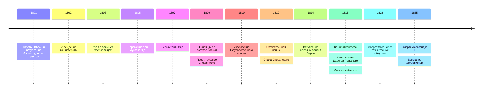

# Александр I. Внутренняя и внешняя политика

> [!abstract]+ 🎯 О чём лекция
> 1. Гибель Павла I и начало царствования Александра I.
> 2. Ранние преобразования в управлении, крестьянском вопросе и образовании.
> 3. Войны с Наполеоном, территориальные изменения и европейская политика России.
> 4. Проекты М. М. Сперанского и пределы реформ.
> 5. Поздний период правления и предпосылки движения декабристов.

> [!info] 🔗 Связь с прошлой лекцией
> Продолжение темы [[26.11.16 — Екатерина II. Просвещённый абсолютизм, внутренняя и внешняя политика]]: после эпохи Екатерины II и короткого правления Павла I началось царствование Александра I.

## 📑 Оглавление

- [[#🏛️ 1. Смена власти и начало правления|🏛️ 1. Смена власти и начало правления]]
- [[#⚙️ 2. Ранние внутренние преобразования|⚙️ 2. Ранние внутренние преобразования]]
- [[#🎓 3. Просвещение и общественные настроения|🎓 3. Просвещение и общественные настроения]]
- [[#🌍 4. Внешняя политика|🌍 4. Внешняя политика]]
- [[#📜 5. Проекты Сперанского|📜 5. Проекты Сперанского]]
- [[#🕯️ 6. Позднее правление и декабристы|🕯️ 6. Позднее правление и декабристы]]
- [[#🗓️ Хронология|🗓️ Хронология]]
- [[#👤 Персоналии|👤 Персоналии]]
- [[#📖 Термины|📖 Термины]]
- [[#🧠 Самопроверка|🧠 Самопроверка]]

## 🏛️ 1. Смена власти и начало правления

### Павел I и переворот 1801 года

Павел I (1796–1801) пытался изменить порядки екатерининского двора, укрепить дисциплину и сократить часть расходов. Его политика вызывала сопротивление придворной знати и части офицерства. В ночь с **11 на 12 марта 1801 года** (по старому стилю; 23–24 марта по новому) заговорщики убили императора в Михайловском замке. В официальном объявлении причиной смерти назвали **апоплексический удар**.

Александр Павлович знал о заговоре против отца, однако степень его осведомлённости о планах убийства остаётся предметом споров. Распространённое изложение состоит в том, что он рассчитывал на отречение Павла и после убийства испытал потрясение.

> [!warning] ⚠️ Предел достоверности
> Подробности последних минут Павла I, реакция Александра и реплики участников известны главным образом по воспоминаниям, которые расходятся между собой. Их нельзя пересказывать как бесспорный протокол событий.

### Новый политический курс

Александр I правил **в 1801–1825 годах**. Начало царствования сопровождалось амнистией, возвращением части опальных чиновников и обещанием управлять по законам и принципам Екатерины II. Воспитанный при дворе бабушки, он был знаком с идеями Просвещения. Однако личные качества монарха сами по себе не объясняют успехи и неудачи реформ: на решения влияли интересы дворянства, устройство самодержавия и войны.

> [!important] 💡 Главный вопрос лекции
> Почему при Александре I появились проекты изменения самодержавного строя и крепостного права, но основные устои империи сохранились?

## ⚙️ 2. Ранние внутренние преобразования

### Негласный комитет и органы управления

В **1801–1803 годах** император обсуждал преобразования с близкими советниками в **Негласном комитете**. Среди участников — В. П. Кочубей, Н. Н. Новосильцев, П. А. Строганов и А. Е. Чарторыйский. Комитет не был законодательным органом.

> [!example] 🔎 Аналогия преподавателя
> Негласный комитет сопоставлен с Избранной радой Ивана IV: в обоих случаях государь опирался на круг советников. Состав, полномочия и исторические обстоятельства этих объединений различались.

В **1802 году** вместо петровских коллегий учредили министерства. Министр отвечал за своё ведомство лично; это было изменением принципа управления, а не простой заменой названий. Среди первых ведомств были министерства внутренних дел, финансов и народного просвещения. В **1810 году** появился Государственный совет — законосовещательный орган при императоре. Его решения не ограничивали верховную власть государя.

### Земля и крестьянский вопрос

Указ **1801 года** разрешил купцам, мещанам и государственным крестьянам приобретать **незаселённые земли**. Он расширил возможности недворян участвовать в землевладении, но не дал им права владеть крепостными крестьянами.

**Указ о вольных хлебопашцах 1803 года** позволял помещику по соглашению с крепостными отпускать их на волю **с землёй** на оговорённых условиях, в том числе с выкупом или повинностями. Решение зависело от помещика, поэтому указ не отменял крепостное право и затронул небольшую долю крестьян.

| 📌 Мера | Что изменила | Чего не изменила |
|---|---|---|
| Покупка незаселённой земли, 1801 | Расширила круг собственников земли | Не разрешила недворянам владеть крепостными |
| Указ о вольных хлебопашцах, 1803 | Создал законный путь освобождения с землёй по соглашению | Не сделал освобождение обязательным |
| Министерская реформа, 1802 | Разделила ведомства и ввела личную ответственность министров | Не установила парламентский контроль |
| Государственный совет, 1810 | Упорядочил обсуждение законопроектов | Не стал независимой законодательной властью |

> [!warning] ⚠️ О цифрах
> Прозвучавшая в лекции оценка «около 1 %» освобождённых по указу 1803 года зависит от периода подсчёта и выбранной базы сравнения. Надёжный вывод: мера имела **ограниченный масштаб**.

## 🎓 3. Просвещение и общественные настроения

Школьная реформа **1803–1804 годов** выстроила систему приходских и уездных училищ, гимназий и университетов. В начале царствования открылись университеты в **Дерпте (1802), Вильне (1803), Казани (1804) и Харькове (1805)**. Царскосельский лицей открылся в **1811 году**; среди его воспитанников был А. С. Пушкин.

В **1812 году** открылась Таврическая губернская гимназия в Симферополе, позднее известная как Симферопольская мужская гимназия. Это пример развития образования на территории империи. Однако открытие университетов на окраинах нельзя объяснять только стремлением правительства «вознаградить» присоединённые земли: цели образовательной политики были шире, а история каждого учреждения различалась.

Во дворянской среде распространялись европейские языки, литература и идеи. До войны 1812 года часть русской образованной публики восхищалась карьерой и реформами Наполеона; военное столкновение с Францией изменило отношение многих современников.

> [!example] 📚 Литературный пример преподавателя
> В «Войне и мире» Л. Н. Толстого князь Андрей Болконский переосмысливает своё восхищение Наполеоном после Аустерлица. Роман написан позднее изображаемых событий и помогает понять их художественное осмысление, но не служит прямым свидетельством настроений всех офицеров.

## 🌍 4. Внешняя политика

### От коалиций к Тильзиту

Россия участвовала в антифранцузских коалициях. В **1805 году** русско-австрийские войска потерпели поражение при **Аустерлице**; в **1806–1807 годах** Россия воевала с Францией в союзе с Пруссией. Сражение при **Прейсиш-Эйлау** (1807) не принесло решающей победы ни одной из сторон. После поражения русской армии при **Фридланде** был заключён **Тильзитский мир (1807)**. Россия признала изменения в Европе, согласилась присоединиться к континентальной блокаде Великобритании и на время стала союзницей Франции. Противоречия между державами сохранялись.

### 1812 год и европейские итоги

В **1812 году** армия Наполеона вторглась в Россию. Война стала Отечественной; в сопротивлении участвовали регулярная армия, ополчение и партизанские отряды. После изгнания французских войск русская армия участвовала в **заграничных походах 1813–1814 годов**. Союзные войска вступили в **Париж в 1814 году**.

По итогам войны со Швецией Россия получила **Финляндию (1809)**. После Венского конгресса **1814–1815 годов** большая часть бывшего Герцогства Варшавского вошла в состав Российской империи как **Царство Польское**; в 1815 году ему даровали конституцию. Территориальные итоги царствования не исчерпывались Европой: войны с Османской империей и Персией также изменили границы России.

В **1815 году** Александр I участвовал в создании **Священного союза** с монархами Австрии и Пруссии. Союз выражал стремление монархов поддерживать послевоенный порядок в Европе. Его нельзя смешивать с **Союзом трёх императоров 1873 года**.

> [!important] 🧭 Уточнение периодизации
> Победа над Наполеоном усилила международный авторитет Александра I, но утверждение, будто **после 1812 года он полностью прекратил реформы**, неверно. В послевоенные годы появились конституция Царства Польского и меры по освобождению крестьян в прибалтийских губерниях; одновременно усиливались охранительные тенденции.

## 📜 5. Проекты Сперанского

### Замысел реформ

**Михаил Михайлович Сперанский** — один из главных государственных деятелей первых лет царствования. В **1809 году** он подготовил проект **«Введение к уложению государственных законов»**. Проект предполагал упорядочить систему управления, разделить законодательные, исполнительные и судебные функции, создать представительные учреждения. Полностью он осуществлён не был.

Реальными шагами стали учреждение **Государственного совета (1810)** и дальнейшее устройство министерств (**1811**). Указы **1809 года** связывали продвижение по гражданской службе с образованием и знаниями. Финансовые меры, проводившиеся при участии Сперанского, вызвали недовольство привилегированных слоёв. Сводить конфликт с дворянством к «общему налогу для всех дворян» было бы неточно: речь шла о разных мерах, включая налоговое обложение отдельных категорий землевладельцев и служащих.

### Опала и возвращение

На фоне обострения отношений с Францией и противодействия при дворе в **1812 году** Сперанского отстранили от должностей и выслали сначала в Нижний Новгород, затем в Пермь. **При Александре I** он вернулся на государственную службу: в 1816 году стал пензенским губернатором, позднее — сибирским генерал-губернатором. При Николае I руководил масштабной систематизацией законодательства. Были подготовлены **Полное собрание законов Российской империи** и **Свод законов Российской империи** — разные издания.

> [!warning] ⚠️ Оценка причин опалы
> Объяснение, что Александр «назначил Сперанского виновником всех неудач», — интерпретация. Достоверно установлены отстранение, ссылка и последующее возвращение реформатора на службу; мотивы императора обсуждаются историками.

## 🕯️ 6. Позднее правление и декабристы

Послевоенный курс сочетал отдельные преобразования с усилением контроля. В **1816–1819 годах** личную крепостную зависимость крестьян отменили в прибалтийских губерниях, но землю за помещиками в основном сохранили. С **1816 года** развивались **военные поселения**, тесно связанные с А. А. Аракчеевым: солдаты и их семьи совмещали военную службу с сельским трудом при строгой регламентации жизни.

В поздние годы царствования усилился религиозный интерес Александра I. Масонские ложи и другие тайные общества были запрещены в **1822 году**. Утверждение, что сам император состоял «в нескольких масонских ложах», требует отдельного документального подтверждения.

Часть образованных дворян и офицеров, прошедших наполеоновские войны, стремилась к отмене крепостного права и ограничению самодержавия. Их взгляды и проекты различались. После смерти Александра I в **1825 году** неопределённость престолонаследия создала условия для выступления декабристов **14 декабря по старому стилю (26 декабря по новому)** на Сенатской площади. Восстание было подавлено при Николае I; пятерых руководителей казнили, многих участников отправили на каторгу и в ссылку. Это событие относится уже к **началу правления Николая I**, хотя его предпосылки сложились раньше.

> [!quote] ✍️ Современник эпохи
> Пушкинское выражение «Дней Александровых прекрасное начало» передаёт память о надеждах начала царствования. Оно не означает, что всё правление сводилось к простой схеме «сначала реформы, затем только реакция».

## 🗓️ Хронология

| Год | Событие |
|---|---|
| **1801** | Убийство Павла I; начало правления Александра I; разрешение недворянам покупать незаселённую землю |
| **1802** | Учреждение министерств |
| **1803–1804** | Школьная и университетская реформы; указ о вольных хлебопашцах (1803) |
| **1805–1807** | Войны с Наполеоном; Аустерлиц (1805), Тильзит (1807) |
| **1809–1811** | Финляндия присоединена к России; проект Сперанского; Государственный совет; реорганизация министерств |
| **1812–1814** | Отечественная война и заграничные походы русской армии |
| **1815** | Венский конгресс; Царство Польское в составе империи; Священный союз |
| **1816–1819** | Освобождение крестьян от личной зависимости в прибалтийских губерниях; развитие военных поселений |
| **1822–1825** | Запрет тайных обществ; смерть Александра I; восстание декабристов |

## 👤 Персоналии

| Персона | Ключевое |
|---|---|
| **Павел I** | Император в 1796–1801 годах; убит заговорщиками |
| **Александр I** | Император в 1801–1825 годах; реформы управления, войны с Наполеоном, участие в устройстве послевоенной Европы |
| **М. М. Сперанский** | Автор плана государственных преобразований 1809 года; руководитель кодификации законов при Николае I |
| **А. А. Аракчеев** | Государственный деятель, связанный с организацией военных поселений |
| **Наполеон Бонапарт** | Французский император; противник России в войнах начала XIX века |
| **А. С. Пушкин** | Воспитанник Царскосельского лицея; в стихах осмыслил начало эпохи Александра I |
| **Николай I** | Преемник Александра I; подавил восстание декабристов |

## 📖 Термины

- 🏛️ **Негласный комитет** — неофициальный круг молодых советников Александра I в начале правления.
- ⚙️ **Министерство** — центральное ведомство во главе с министром, лично отвечавшим за свою сферу.
- 🌾 **Вольные хлебопашцы** — категория крестьян, освобождённых помещиками с землёй по указу 1803 года на согласованных условиях.
- 📜 **Государственный совет** — высший законосовещательный орган, учреждённый в 1810 году.
- 🧭 **Континентальная блокада** — созданная Наполеоном система торговых ограничений против Великобритании.
- 🤝 **Священный союз** — объединение монархов России, Австрии и Пруссии, провозглашённое в 1815 году.
- 🪖 **Военные поселения** — система совмещения военной службы и сельского хозяйства при жёсткой регламентации.
- 🕯️ **Декабристы** — участники тайных обществ, выступившие против самодержавия в декабре 1825 года.

## 🧠 Самопроверка

> [!question]- 🤔 Развернуть вопросы
> - [ ] Чем Негласный комитет отличался от Государственного совета?
> - [ ] Почему учреждение министерств было содержательной реформой управления?
> - [ ] Какие условия ставил указ о вольных хлебопашцах и почему его результаты были ограниченными?
> - [ ] Какие события привели к Тильзитскому миру и почему союз с Францией оказался непрочным?
> - [ ] Что предлагал Сперанский и какие части его плана были осуществлены?
> - [ ] Почему нельзя считать 1812 год датой полного прекращения реформ?
> - [ ] Как войны и образование повлияли на взгляды будущих декабристов?

> [!todo] ✅ Что дополнить / Что проверить
> - [ ] Уточнить по надёжному исследованию долю крестьян, освобождённых именно по указу 1803 года, и указать период подсчёта; формула «около 1 %» без этих условий неточна.
> - [ ] Проверить по историческим источникам степень осведомлённости Александра о плане убийства Павла I и детали реакции на его смерть; свидетельства противоречат друг другу.
> - [ ] Проверить документами утверждение о личном членстве Александра I в масонских ложах; в конспект оно не принято как факт.
> - [ ] Уточнить, какие именно финансовые меры Сперанского имелись в виду в лекции: фрагмент расшифровки о «налогах для дворян» не позволяет восстановить их точный перечень.
> - [ ] Если понадобится подробная тема 1812 года, дополнить конспект материалами следующего семинара, о котором упоминает преподаватель.

### Источники для проверки

- [Президентская библиотека — Александр I](https://www.prlib.ru/history/619833)
- [Президентская библиотека — М. М. Сперанский](https://www.prlib.ru/history/618936)
- [Президентская библиотека — восстание декабристов](https://www.prlib.ru/history/619844)
- [Президентская библиотека — крестьянская реформа и её предыстория](https://www.prlib.ru/collections/467127)
- [Музей истории города Симферополя — народное просвещение](https://museum-of-simferopol-history.ru/%D0%BF%D0%B5%D1%80%D0%B2%D1%8B%D0%B9-%D0%B7%D0%B0%D0%BB/%D0%B2%D1%8B%D1%81%D1%82%D0%B0%D0%B2%D0%BA%D0%B0-%D0%B4%D0%B0%D1%80%D1%8B-%D0%B4%D1%80%D1%83%D0%B7%D0%B5%D0%B9-%D0%B8-%D0%BF%D0%B0%D1%80%D1%82%D0%BD%D0%B5%D1%80%D0%BE%D0%B2-%D1%81%D0%B8%D0%BC/)
